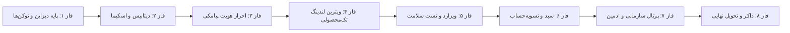

> **بایگانی:** این سند با [HANDOVER.md](../HANDOVER.md) جایگزین شده و فقط برای سابقه نگه داشته شده است.

# 🧬 سند جامع معماری و پروتکل اجرای خودمختار ایجنت
# Maya Spirulina | Agent Master Blueprint & Autonomous Execution Protocol

> **راهنمای الزام‌آور برای کلیه مدل‌ها و ایجنت‌های هوش مصنوعی (Agent Instruction):**  
> این سند یک **قرارداد مهندسی و اجرایی (Execution Contract)** است. هر ایجنت فعال در این پروژه موظف است این سند را به عنوان راهنمای قطعی اجرای کارها رعایت کرده و تحت هیچ شرایطی از پالت طراحی، معماری نرم‌افزار، استانداردهای کامپایل و دروازه‌های پذیرش (Definition of Done) تخطی نکند.

---

## فهرست سرفصل‌های سند
1. [ستون ۱: منشور هویت برند و محدوده پروژه (Scope & Brand Identity)](#۱-منشور-هویت-برند-و-محدوده-پروژه)
2. [ستون ۲: قرارداد آهنین سیستم طراحی و تم (Design System Contract)](#۲-قرارداد-آهنین-سیستم-طراحی-و-تم)
3. [ستون ۳: پشته فنی و استانداردهای کدنویسی (Tech Stack & Quality)](#۳-پشته-فنی-و-استانداردهای-کدنویسی)
4. [ستون ۴: نقشه راه فازبندی‌شده اتمیک (Atomic Phased Roadmap)](#۴-نقشه-راه-فازبندی‌شده-اتمیک)
5. [ستون ۵: دروازه پذیرش کیفیت (Definition of Done - DoD)](#۵-دروازه-پذیرش-کیفیت-definition-of-done)
6. [ستون ۶: پروتکل تداوم بافت و ریکاوری سشن (Context Continuity)](#۶-پروتکل-تداوم-بافت-و-ریکاوری-سشن)
7. [ستون ۷: الگوی استاندارد گزارش‌دهی ایجنت (Agent Reporting Template)](#۷-الگوی-استاندارد-گزارش‌دهی-ایجنت)

---

## ۱. منشور هویت برند و محدوده پروژه

### ۱.۱. تعریف مأموریت
* **نام تجاری:** مایا اسپیرولینا | **Maya Spirulina**
* **ماهیت محصول:** پلتفرم اختصاصی تک‌محصولی مکمل سوپرفود خالص و بیوتکنولوژی (Single-Product DTC Biotech Superfood).
* **محصول محوری:** اسپیرولینا خالص فرآوری‌شده در دو فرمت:
  1. کپسول ۵۰۰ میلی‌گرم فشرده سرد (Cold-Pressed Capsules).
  2. پودر خالص میکرونیزه مزارع ایزوله (Micronized Pure Powder).
* **دوره‌های مصرف هدفمند:** بسته‌های ۳۰ روزه (شروع بازسازی)، ۶۰ روزه (تعادل سیستم ایمنی) و ۱۲۰ روزه (تحول سلولی کامل).

### ۱.۲. مرزهای منفی و خطوط قرمز (Out-of-Scope Guardrails)
ایجنت مجاز به اجرای موارد زیر **نیست**:
- ❌ تبدیل سایت به فروشگاه عمومی چندمحصولی (E-Commerce Catalog با صدها کالای متفرقه).
- ❌ استفاده از رنگ‌ها و پالت‌های متفرقه (بنفش، آبی کاربنی، صورتی، نارنجی جیغ).
- ❌ هاردکد کردن اعداد انگلیسی یا قیمت‌های ریالی بدون تبدیل استاندارد به تومان فارسی.
- ❌ حذف یا غیرفعال کردن تست‌های بیلد تایپ‌اسکریپت با `// @ts-ignore` یا `any`.
- ❌ ادغام المان‌های گرافیکی کارتونی، ایموجی‌های بیش‌ازحد یا انحناهای اغراق‌آمیز نامتناسب با فضای پزشکی-بیوتکنولوژی.

---

## ۲. قرارداد آهنین سیستم طراحی و تم

### ۲.۱. تم بصری: استودیو دارک مدرن (Modern Dark Studio)
کل سیستم بر پایه متریال شیشه تیره استودیویی، بردرهای مویی ۱ پیکسلی و درخشش نئون زمردی (High-End Lab Aesthetic) پیاده‌سازی می‌شود.

```css
/* ==========================================================================
   CSS Design Tokens (src/app/globals.css)
   ========================================================================== */
:root {
  /* سطوح و پس‌زمینه‌ها */
  --bg-page:         #070a10;   /* آبسیدین کربنی مات - پس‌زمینه سراسری */
  --bg-card:         #0d121c;   /* کارت‌ها و کانتینرهای سطح ۱ */
  --bg-subtle:       #0e1422;   /* سایدبار، دراورها و پنل‌های سطح ۲ */
  --bg-glass:        rgba(13, 18, 28, 0.75); /* سطوح شیشه‌ای بلورین */

  /* خطوط و حاشیه‌های مهندسی */
  --border-hairline: rgba(255, 255, 255, 0.08); /* بردرهای ظریف ۱ پیکسلی */
  --border-strong:   rgba(255, 255, 255, 0.16); /* بردر المان‌های هاور و اینپوت‌ها */
  --border-accent:   rgba(16, 185, 129, 0.28); /* بردر وضعیت‌های فعال و فوکوس */

  /* پالت متنی با کنتراست آزمایشگاهی */
  --text-main:       #f8fafc;   /* عناوین اصلی و ارقام مهم */
  --text-muted:      #94a3b8;   /* متون توضیحی و زیرعنوان‌ها */
  --text-subtle:     #64748b;   /* برچسب‌های کم‌اهمیت و کدهای سیستمی */

  /* اکسنت نئون زمردی بیوتکنولوژی */
  --accent-primary:  #10b981;   /* زمردی نئون برند (Emerald 500) */
  --accent-hover:    #34d399;   /* حالت هاور دکمه‌ها و لینک‌ها */
  --accent-deep:     #059669;   /* گرادیان تیره زمردی */
  --accent-glow:     rgba(16, 185, 129, 0.18); /* هاله نوری کارت‌های فعال */

  /* اکسنت شیشه کهربایی دارویی */
  --amber-primary:   #d97706;   /* کهربایی بطری دارویی */
  --amber-soft:      rgba(217, 119, 6, 0.12); /* هایلایت دوره‌های مصرف */

  /* فونت و انحناها */
  --font-family:     var(--font-vazirmatn), system-ui, sans-serif;
  --radius-sm:       6px;       /* چیپ‌ها، تگ‌ها و بج‌ها */
  --radius-md:       8px;       /* دکمه‌ها و اینپوت‌ها */
  --radius-lg:       12px;      /* کارت‌های استاندارد */
  --radius-xl:       16px;      /* کارت‌های شاخص هیرو و مودال‌ها */
}
```

### ۲.۲. وضعیت‌های معنایی مات (Subdued Semantic Colors)
هیچ‌گاه از رنگ‌های خالص و اشباع‌شده برای خطا یا اخطار استفاده نشود:
- **موفقیت (Success):** متن `#34d399` | پس‌زمینه `rgba(16, 185, 129, 0.12)` | بردر `rgba(16, 185, 129, 0.25)`
- **هشدار (Warning):** متن `#fbbf24` | پس‌زمینه `rgba(245, 158, 11, 0.12)` | بردر `rgba(245, 158, 11, 0.25)`
- **خطا / حذف (Danger):** متن `#fb7185` | پس‌زمینه `rgba(244, 63, 94, 0.12)` | بردر `rgba(244, 63, 94, 0.25)`
- **اطلاعات (Info):** متن `#38bdf8` | پس‌زمینه `rgba(14, 165, 233, 0.12)` | بردر `rgba(14, 165, 233, 0.25)`

### ۲.۳. قانون طلایی ارقام و تایپوگرافی RTL
- کلیه صفحات دارای ویژگی `dir="rtl"` و `lang="fa"` هستند.
- تمام ارقام عددی (قیمت، درصد، موجودی، روزهای مصرف) **باید** با توابع زیر رندر شوند:
  - `formatToman(price)`: تبدیل به تومان با جداکننده هزارگان و ارقام فارسی (مثال: `۷۸۰,۰۰۰ تومان`).
  - `toPersianDigits(value)`: تبدیل ارقام انگلیسی به فارسی (مثال: `۳۰ روز`).

---

## ۳. پشته فنی و استانداردهای کدنویسی

| بخش | ابزار و نسخه | استاندارد اجباری |
| :--- | :--- | :--- |
| **فریم‌ورک هسته** | Next.js 16+ (App Router) | روت‌ها با Server Components به جز تعاملات کلاینت با `'use client'` |
| **زبان** | TypeScript 5+ | تایپ دقیق تمام اینترفیس‌ها؛ ممنوعیت استفاده از `any` |
| **استایل‌دهی** | Tailwind CSS v4 + Pure CSS Tokens | فقط استفاده از کلاس‌های هماهنگ با توکن‌های `globals.css` |
| **پایگاه داده و ORM** | PostgreSQL + Prisma ORM | اسکیما در `prisma/schema.prisma` با کلیدهای یکتا و ریلیشن‌های امن |
| **سشن و احراز هویت** | JWT با کتابخانه `jose` | توکن HttpOnly ایمن در کوکی `auth_token` بدون افشای سشن در کلاینت |
| **مدیریت وضعیت** | React Context API | `CartContext` و `ThemeContext` همراه با ماندگاری در `localStorage` |
| **روتینگ امنیتی** | `src/proxy.ts` (Next.js 16 API) | جایگزین `middleware.ts` برای تفکیک دسترسی پرتال ادمین و مشتری |

---

## ۴. نقشه راه فازبندی‌شده اتمیک (Atomic Phased Roadmap)

هر فاز مستقل و خودکفاست. ایجنت باید فازها را **دقیقاً به ترتیب** اجرا کند و تا یک فاز پاس نشود، ورود به فاز بعدی ممنوع است.



---

### فاز ۱: زیرساخت طراحی و توکن‌های استودیو دارک
- **هدف:** قفل‌کردن ظاهر بصری، فونت وزیرمتن، متغیرهای CSS و کامپوننت‌های پایه.
- **فایل‌های هدف:**
  - `src/app/globals.css` (تعریف کامل توکن‌های `:root`، `.card-spotlight`، `.btn-biotech`، `.data-table`).
  - `src/app/layout.tsx` (پیکربندی فونت وزیرمتن، تگ‌های متا و `dir="rtl"`).
- **معیار اعتبارسنجی:** کامپایل بدون خطای CSS و رندر یک پس‌زمینه آبسیدین با تایپوگرافی شارپ و یکنواخت.

---

### فاز ۲: مدل‌سازی داده و زیرساخت پایگاه داده (Prisma Schema)
- **هدف:** طراحی اسکیما برای محصول تک‌محور، نقش‌های کاربری، سفارشات و مالی.
- **فایل‌های هدف:**
  - `prisma/schema.prisma`
  - `src/lib/prisma.ts` (کلاینت Singleton با قابلیت کش در محیط dev).
- **مدل‌های کلیدی:**
  - `User` با نقش‌های `CUSTOMER`, `AMBASSADOR`, `ADMIN`, `SUPER_ADMIN`.
  - `Product` با فیلدهای `servingFormat` (کپسول/پودر)، `batchNumber`، `labReportUrl`.
  - `Order`, `OrderItem`, `Wallet`, `Settlement`.
- **معیار اعتبارسنجی:** اجرای موفق `npx prisma validate` یا `npx prisma generate`.

---

### فاز ۳: سیستم احراز هویت پیامکی بدون رمز (OTP Authentication)
- **هدف:** ثبت‌نام و ورود سریع با شماره موبایل ایران و سشن JWT بدون حالت.
- **فایل‌های هدف:**
  - `src/app/api/auth/otp/send/route.ts` (اعتبارسنجی فرمت شماره موبایل و ریت‌لیمیتینگ).
  - `src/app/api/auth/otp/verify/route.ts` (بررسی کد و ایجاد کوکی `auth_token`).
  - `src/proxy.ts` (بررسی توکن و هدایت نقش‌ها).
  - `src/app/login/page.tsx` (فرم ورود شیک با تایمر معکوس دریافت مجدد کد).
- **معیار اعتبارسنجی:** تست موفق ارسال و تایید کد با دریافت پاسخ `200 OK` و ذخیره کوکی در مرورگر.

---

### فاز ۴: ویترین لندینگ پیج تک‌محصولی متمرکز بر تبدیل
- **هدف:** صفحه اصلی روایت‌محور (Storytelling DTC Landing) با محوریت اسپیرولینا مایا.
- **فایل‌های هدف:**
  - `src/app/page.tsx`
  - `src/components/storefront/HeroStudio.tsx` (رندر بطری کهربایی، نورپردازی استودیو و مزایای بالینی).
  - `src/components/storefront/LabAnalytics.tsx` (نمودارهای میله‌ای مقایسه‌ای فیکوسیانین، پروتئین و آهن).
  - `src/components/storefront/PackSelector.tsx` (انتخاب دوره ۳۰، ۶۰ یا ۱۲۰ روزه با محاسبه سود خرید).
  - `src/components/storefront/SocialProof.tsx` (نظرات پزشکان و خریداران با نشان تایید اصالت).
- **معیار اعتبارسنجی:** بیلد کامل با سرعت لود زیر ۱ ثانیه و کنتراست رنگی بی‌نقص.

---

### فاز ۵: ویزارد تشخیص هوشمند و تحلیل بالینی (Health Diagnostic Quiz)
- **هدف:** هدایت خریدار به بهترین دوره مصرف بر اساس علائم فردی بدون نیاز به دانش پزشکی.
- **فایل‌های هدف:**
  - `src/app/diagnostic/page.tsx` یا مودال تعاملی در لندینگ.
  - `src/data/diagnostic-questions.ts` (سوالات خستگی مزمن، ضعف سیستم ایمنی، سلامت پوست و مو، ورزش).
  - محاسبه الگوریتمی پیشنهاد بسته و افزودن مستقیم بسته پیشنهادی به سبد خرید.
- **معیار اعتبارسنجی:** طی‌شدن کامل مراحل ویزارد و انتقال به دراور سبد خرید با تخفیف آنی.

---

### فاز ۶: سبد خرید دراور و تسویه‌حساب تک‌صفحه‌ای (Checkout & Payment)
- **هدف:** تسویه‌حساب سریع بدون انقطاع.
- **فایل‌های هدف:**
  - `src/lib/cart-context.tsx` (مدیریت سبد خرید با `localStorage`).
  - `src/components/storefront/CartDrawer.tsx` (دراور کشویی شیشه‌ای با نوار پیشرفت ارسال رایگان).
  - `src/app/checkout/page.tsx` (فرم تک‌صفحه‌ای آدرس، انتخاب ارسال پیشتاز/پیک و کوپن تخفیف).
  - `src/app/checkout/success/page.tsx` (نمایش شماره فاکتور و کد رهگیری پستی با دکمه چاپ).
- **معیار اعتبارسنجی:** ثبت سفارش تستی، تولید کد پیگیری `ORD-XXXXXX` و پاکسازی خودکار سبد.

---

### فاز ۷: پیشخوان سازمانی، مدیریت انبار و حسابداری (Admin Suite)
- **هدف:** مدیریت حرفه‌ای فروش، انبارداری با شماره پارت (Batch No) و تراز مالی (P&L).
- **فایل‌های هدف:**
  - `src/app/portal/admin/page.tsx` و `src/components/admin/AdminDashboardClient.tsx`.
  - `src/components/admin/AdminOverview.tsx` (آنالیتیکس لحظه‌ای درآمد و سفارشات).
  - `src/components/admin/InventoryManager.tsx` (کنترل موجودی کپسول/پودر با آستانه هشدار اتمام).
  - `src/components/admin/AccountingManager.tsx` (دفتر روزنامه، درآمد خالص و سود عملیاتی).
- **معیار اعتبارسنجی:** کارکرد صحیح پالت فرمان کیبورد (`Ctrl+K`) و تب‌های مجزا بدون رفرش صفحه.

---

### فاز ۸: داکریزه کردن، پایش کیفیت و استقرار نهایی (Docker & Production)
- **هدف:** محیط کانتینری ایزوله و آماده تحویل سرور لینوکس.
- **فایل‌های هدف:**
  - `Dockerfile` (ساختار چندمرحله‌ای بهینه‌سازی‌شده برای Next.js Standalone).
  - `docker-compose.yml` (کانتینرهای Next.js، PostgreSQL و Redis).
  - `.env.example` (مستندسازی متغیرهای محیطی).
- **معیار اعتبارسنجی:** اجرای موفق `npm run build` با کد خروجی `Exit Code: 0` و استقرار بدون خطا در داکر.

---

## ۵. دروازه پذیرش کیفیت (Definition of Done - DoD)

هیچ ایجنتی مجاز نیست یک فاز را تمام‌شده تلقی کند یا تیک آن را بزند، مگر آنکه هر **۶ شرط زیر** کاملاً احراز شده باشند:

```
[ ] ۱. کامپایل بدون خطا (Zero-Error Build):
       اجرای دستور npm run build بدون هیچ هشدار یا خطای تایپ‌اسکریپت (Exit Code: 0).
[ ] ۲. تطابق ۱۰۰٪ با سیستم طراحی:
       تمامی کلاس‌ها از متغیرهای رسمی globals.css استفاده کرده و هیچ رنگ متفرقه‌ای وارد نشده است.
[ ] ۳. پشتیبانی کامل از زبان فارسی و راست‌چین:
       جهت‌گیری RTL، فونت وزیرمتن و تبدیل تمام ارقام به فارسی با formatToman و toPersianDigits.
[ ] ۴. واکنش‌گرایی بی‌نقص (Mobile-First):
       رندر استاندارد در تمام نمایشگرها (موبایل ۳۷۵px تا دسکتاپ ۱۹۲۰px) بدون اسکرول افقی ناخواسته.
[ ] ۵. پاکسازی کدهای تستی و امنیتی:
       عدم وجود داده‌های حساس، کلیدهای هاردکدشده یا console.logهای اضافه در کدها.
[ ] ۶. به‌روزرسانی مستندات و نقشه راه:
       تغییر وضعیت فاز به «✅ تکمیل شد» در PROJECT_ROADMAP.md همراه با ثبت لیست فایل‌ها.
```

---

## ۶. پروتکل تداوم بافت و ریکاوری سشن (Context Continuity)

در صورتی که ارتباط با ایجنت قطع شود یا پنجره مکالمه فشرده (Compacted) گردد:
1. **گام ۱:** ایجنت جدید موظف است در ابتدا **این سند (`AGENT_MASTER_BLUEPRINT.md`)** و **`PROJECT_ROADMAP.md`** را بخواند.
2. **گام ۲:** آخرین فاز تکمیل‌شده دارای علامت `[x]` را پیدا کرده و متوجه موقعیت فعلی شود.
3. **گام ۳:** **فقط و فقط** اولین فاز تکمیل‌نشده بعدی `[ ]` را در دستور کار قرار دهد و از ورود به فازهای بعد از آن خودداری کند.
4. **گام ۴:** پس از اتمام فاز، چک‌لیست DoD را بررسی و سند را به‌روزرسانی کند.

---

## ۷. الگوی استاندارد گزارش‌دهی ایجنت (Agent Reporting Template)

پس از اجرای هر فاز، پاسخ ایجنت به کاربر باید در این قالب دقیق و بدون حاشیه‌پردازی ارسال شود:

```markdown
### 🚀 گزارش اتمام فاز [شماره فاز]: [عنوان فاز]

#### ۱. اقدامات انجام‌شده
- [فایل الف]: پیاده‌سازی کامپوننت ...
- [فایل ب]: تنظیم هوک ...

#### ۲. وضعیت دروازه کیفیت (DoD Verification)
- ✅ کامپایل تایپ‌اسکریپت: `npm run build` (Exit Code: 0)
- ✅ سیستم طراحی: پایبندی کامل به پالت استودیو دارک و زمردی
- ✅ زبان و ارقام: ۱۰۰٪ فارسی و راست‌چین

#### ۳. وضعیت نقشه راه
- وضعیت فاز [شماره فاز] در مستندات به `✅ تکمیل شد` ارتقا یافت.

#### ۴. گام پیشنهادی بعدی
- آمادگی برای شروع فاز [شماره فاز بعدی]: [عنوان فاز بعدی]. آیا دستور اجرا صادر می‌شود؟
```

---
*این سند منشور رسمی توسعه پروژه «مایا اسپیرولینا» است و هرگونه تغییر در مفاد آن نیازمند تایید مستقیم کارفرما می‌باشد.*
