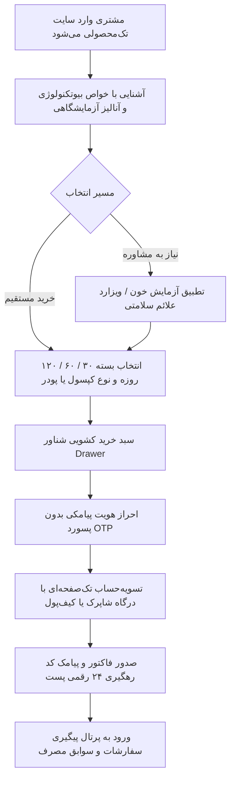

> **بایگانی:** این سند با [HANDOVER.md](../HANDOVER.md) جایگزین شده و فقط برای سابقه نگه داشته شده است.

# 🧬 سند جامع دستورالعمل استاندارد تحویل ایده به ایجنت هوش مصنوعی
# Maya Spirulina Platform | Complete Agent Handover & Execution Specification
**تاریخ تدوین:** ۱ مهر ۱۴۰۵ | **نسخه:** ۲.۰ جامع نهایی  
**منبع استاندارد:** دستورالعمل استاندارد تحویل ایده به ایجنت (از ایده تا محصول با ثبت وضعیت هر مرحله)

---

## 📌 راهنمای نحوه استفاده برای کارفرما (Prompt Execution Guide)
> **کارفرمای گرامی:** شما می‌توانید کل متن این سند را به صورت یک‌جا کپی کرده و به عنوان پرامپت شروع یا فایل راهنما (`SYSTEM PROMPT` یا سند مبنا) به هر ایجنت هوش مصنوعی (مانند Claude، GPT-4o، DeepSeek، Gemini یا Antigravity) تحویل دهید.
> این سند حاوی تمام **۸ قاعده رفتاری الزامی**، **ساختار منبع یگانه حقیقت (`STATUS.md`)**، **۸ مرحله استاندارد ساخت محصول**، و **پاسخ‌های کامل و با بالاترین جزئیات اختصاصی پلتفرم مایا اسپیرولینا** است تا ایجنت بتواند با حداکثر هماهنگی، وفاداری به هویت برند و بدون خطا پروژه را به سرانجام برساند.

---

# بخش اول: متن استاندارد دستورالعمل حاکم بر ایجنت

## ۱. هدف سند و روش استفاده
این سند یک «دستورالعمل اجرایی» است که شما به عنوان دارنده‌ی ایده، همراه با ایده به یک ایجنت هوش مصنوعی یا هر همکار فنی جدید تحویل می‌دهید. پیام اصلی آن یک جمله است:
> **«این ایده را از صفر تا انتشار طبق مراحل استاندارد پیش ببر، هر جا مبهم بود از من سؤال بپرس، وضعیت هر مرحله را با تیک ثبت کن و در پایان اسناد لازم را تهیه کن.»**

منطق سند بر یک اصل استوار است: پروژه باید یک **«منبع یگانه حقیقت (Single Source of Truth)»** داشته باشد؛ یعنی یک فایل وضعیت زنده به نام `STATUS.md` که همه — انسان یا ایجنت — از روی همان یک فایل بفهمند محصول چیست، چرا ساخته می‌شود، چه تصمیم‌هایی گرفته شده و کار دقیقاً تا کجا پیش رفته است. با این فایل، ورود نفر یا ایجنت جدید به هر نقطه از کار به معنای شروع از صفر نیست؛ فقط ادامه‌ی مسیر ثبت‌شده است.

---

## ۲. قواعد الزامی ایجنت (Mandatory Agent Rules)
ایجنت موظف است در تمام طول پروژه این هشت قاعده را بدون استثنا رعایت کند:

1. **ابتدا فهم، بعد ساخت:**  
   پیش از هر اقدام، فایل وضعیت (`STATUS.md`) را بخوان و «ماهیت ایده» را در یک پاراگراف بازگو کن تا مطمئن شویم درک درست است. اگر فایل وضعیت وجود ندارد، بلافاصله آن را بساز.
2. **در ابهام، سؤال بپرس:**  
   هیچ فرض مهمی را بدون تأیید مالک ایده نادیده نگیر (طبق بخش ۵).
3. **به ترتیب مراحل حرکت کن، اما خطی و یک‌بارمصرف نه:**  
   نتیجه‌ی یک مرحله‌ی بعدی ممکن است تو را به اصلاح مرحله‌ی قبلی برگرداند؛ در آن صورت وضعیت آن مرحله را از `[انجام شده]` به `[بازگشایی شده]` تغییر بده و دلیل را مستند کن.
4. **هر مرحله فقط با خروجی مکتوب تیک می‌خورد:**  
   تیک یعنی خروجی آن مرحله ساخته، ذخیره و در فایل وضعیت لینک شده است؛ نه اینکه «در ذهن بود» یا «گفته شد».
5. **ساخت عمودی قابلیت (Vertical Slicing):**  
   هر قابلیت را از رابط کاربری تا دیتابیس، امنیت و آزمون به صورت یک کار کامل بساز؛ نه اینکه «اول کل فرانت‌اند، بعد کل بک‌اند».
6. **هر تصمیم با دلیل ثبت شود:**  
   هر انتخاب فنی یا محصولی (زبان، دیتابیس، سرویس، دیزاین) با یک جمله دلیل و تاریخ در فایل وضعیت ثبت می‌شود تا نفر بعدی بفهمد چرا.
7. **تغییر وضعیت بلادرنگ:**  
   بعد از هر گام معنادار، فایل وضعیت را همان لحظه به‌روز کن. فایل وضعیت قدیمی یعنی پروژه از دست رفته.
8. **ساده‌سازی آگاهانه:**  
   هر پیچیدگی که اکنون لازم نیست، با برچسب «فعلاً لازم نیست + دلیل» ثبت شود، نه اینکه حذف و فراموش گردد.

---

## ۳. فایل وضعیت پروژه: منبع یگانه حقیقت (`STATUS.md`)
اولین خروجی ایجنت همیشه یک فایل به نام `project-lifecycle/STATUS.md` در مخزن پروژه است که با هر تغییر به‌روز می‌شود. ساختار الزامی آن شامل ۷ بخش زیر است:
* **۱. خلاصه‌ی ایده:** محصول چیست، برای کیست، چه مشکلی را حل می‌کند و موفقیتش چگونه سنجیده می‌شود (حداکثر ۵ جمله).
* **۲. اطلاعات تماس و نقش‌ها:** مالک ایده کیست و تصمیم‌گیرنده‌ی نهایی در هر حوزه چه کسی است.
* **۳. جدول مراحل:** هشت مرحله‌ی استاندارد، هر کدام با وضعیت `[انجام شده] / [در حال انجام] / [منتظر پاسخ مالک] / [بازگشایی شده] / [شروع‌نشده]`، تاریخ آخرین تغییر و لینک به خروجی مکتوب.
* **۴. دفتر تصمیم‌ها (Decision Log):** هر تصمیم مهم با شماره شناسه (DEC-XX)، توضیح، دلیل، گزینه‌های ردشده و تاریخ.
* **۵. سؤال‌های باز (Open Questions):** فهرست سؤال‌های پرسیده‌شده از مالک با شماره (Q-XX)، وضعیت پاسخ و اعلام اینکه کار کدام مرحله تا پاسخ متوقف است.
* **۶. قابلیت‌ها و وضعیت هر کدام (Feature Matrix):** هر قابلیت محوری با معیار پذیرش و درصد تکمیل ۵ لایه (UI، دیتابیس، بیزنس/API، امنیت و سشن، آزمون و بیلد).
* **۷. ورودی بعدی (Next Action):** یک جمله‌ی کاملاً صریح: «قدم بعدی چیست و چه چیزی برای انجام آن لازم است».

> **قاعده‌ی طلایی:** هر کس (یا ایجنت) که وارد پروژه می‌شود، فقط و فقط `STATUS.md` را می‌خواند و کار را از اولین قلمِ شروع‌نشده یا متوقف ادامه می‌دهد.

---

## ۴. مراحل هشت‌گانه استاندارد از ایده تا انتشار
| # | مرحله | خروجی الزامی | شرط عبور (شرط تیک زدن) |
| :-: | :--- | :--- | :--- |
| **۱** | **کشف و اعتبارسنجی** | تعریف دقیق مسئله و شواهد نیاز بازار | مشخص بودن چرایی نیاز به مکمل خالص و درد اصلی مخاطب |
| **۲** | **تعیین محدوده نسخه اول (Scope)** | فهرست قابلیت‌های ضروری (Must) / قابل‌تعویق (Could) / خارج از محدوده (Out) | مشخص باشد دقیقاً چه چیزی در نسخه اول ساخته می‌شود و چه ساخته نمی‌شود |
| **۳** | **سند نیازمندی محصول (PRD)** | نیازمندی‌ها به صورت داستان کاربر با معیار پذیرش و حالات خطا | تمام نیازمندی‌های خرید، پرداخت و رهگیری قابل آزمون باشند |
| **۴** | **طراحی تجربه و رابط کاربری (UI/UX)** | نقشه مسیر کاربر، فهرست صفحات، حالت‌های ۴ گانه هر کامپوننت (خالی، بارگذاری، خطا، موفقیت) و حالت موبایل | مسیر اصلی خرید روی موبایل با تم دارک استودیو کامل دیده شده باشد |
| **۵** | **طراحی فنی (بلوپرینت)** | انتخاب فرانت‌اند، بک‌اند، دیتابیس، معماری داده، سطوح دسترسی و امنیت با ذکر دلایل | ریسک‌ها، تداخل پورت‌ها و مدل احراز هویت کاملاً مکتوب باشند |
| **۶** | **ساخت تدریجی (عمودی)** | پیاده‌سازی قابلیت‌به‌قابلیت به صورت کامل و عمودی با کنترل نسخه | هر قابلیت معیار پذیرش خود را از دیتابیس تا UI با موفقیت پاس کند |
| **۷** | **آزمون و آماده‌سازی انتشار** | آزمون مسیر اصلی خرید، سناریوهای خرابی، تست امنیت و کامپایل ۱۰۰٪ سبز بیلد | بیلد موفق تولیدی (Exit Code: 0) بدون خطا یا اخطار تایپ‌اسکریپت |
| **۸** | **انتشار و بهبود** | مستندسازی داکر، متغیرهای محیطی، پشتیبان‌گیری و مانیتورینگ خطاها | کانتینرهای سرویس در وضعیت سالم (Healthy) بالا بیایند |

---

## ۵. قاعده پرسیدن سؤال در موارد مبهم
1. **چه زمانی سؤال بپرسد؟** هر جا پاسخ بر تصمیم اثر بگذارد: تغییر مخاطب محصول، حذف یا اضافه شدن قابلیت اساسی، تغییر ساختار دیتابیس، مسائل امنیتی، درگاه پرداخت یا هزینه‌ها. جزئیات خرد فرعی و هماهنگ با دیزاین سیستم را خودش تصمیم بگیرد و ثبت کند.
2. **چگونه بپرسد؟** سؤال‌ها را یک‌جا، شماره‌گذاری‌شده و همراه با «گزینه پیشنهادی ایجنت» مطرح کند تا مالک فقط تأیید یا رد کند. هر سؤال فوراً در بخش «سؤال‌های باز» `STATUS.md` ثبت می‌شود.
3. **اگر پاسخ نیامد چه؟** حداکثر پس از یک نوبت یادآوری، کار را روی مسیر کم‌ریسک ادامه دهد، فرض خود را صریح در فایل وضعیت بنویسد («فرض: ثبت دوره ۳۰ روزه به صورت پیش‌فرض، چون پاسخ نیامد») و وضعیت مرحله را «در حال انجام» نگه دارد.

---

## ۶. اسناد تحویلی نهایی در پوشه `project-lifecycle/`
ایجنت موظف است این ۵ سند را به همراه فایل وضعیت تهیه و پیوسته به‌روز نگه دارد:
1. `PRD.md`: سند نیازمندی محصول و داستان‌های کاربری
2. `TECH_DESIGN.md`: سند معماری فنی، دیتابیس و قرارداد APIها
3. `UI_UX_DESIGN.md`: طرح تجربه و رابط کاربری، تم و ۴ حالت کامپوننت‌ها
4. `TEST_PLAN.md`: برنامه جامع آزمون، تست سناریوهای خطا و چک‌لیست بیلد
5. `OPERATIONS_GUIDE.md`: راهنمای استقرار داکر، نگهداری و متغیرهای سرور

---

## ۷. چک‌لیست تحویل کار به نفر یا ایجنت بعدی (Handoff Checklist)
هر بار که کار به ایجنت جدیدی سپرده می‌شود، ۵ بند زیر باید فوراً قابل احراز باشند:
- [x] آخرین نسخه فایل `STATUS.md` با وضعیت به‌روز همه مراحل در دسترس است.
- [x] لینک خروجی‌های انجام‌شده تا امروز در اسناد مکتوب ثبت شده است.
- [x] دفتر تصمیم‌ها و سؤال‌های باز کاملاً شفاف و مستندند.
- [x] ساختار متغیرهای محیطی (`.env.example`) و نکات امنیتی مشخص هستند.
- [x] جمله صریح گام بعدی در بخش ۷ فایل `STATUS.md` درج شده است.

---

# بخش دوم: پاسخ‌های لازم و شناسنامه تخصصی پروژه «مایا اسپیرولینا»
*(این بخش دقیقاً شناسنامه انحصاری محصول است که ایجنت موظف به درک و اجرای مو‌به‌موی آن است)*



### ۱. هویت، تعریف محصول و مأموریت
* **نام تجاری:** مایا اسپیرولینا | **Maya Spirulina**
* **ماهیت سایت:** پلتفرم فروش مستقیم تک‌محصولی فوق‌تخصصی سوپرفود بیوتکنولوژی (Single-Product DTC Biotech Showcase).
* **محصول محوری:** مکمل سوپرفود خالص اسپیرولینا ارگانیک پرورشی مزارع ایزوله در دو فرمت:
  1. کپسول‌های ۵۰۰ میلی‌گرم فشرده سرد (Cold-Pressed Pure Capsules) بدون هرگونه ماده نگهدارنده یا ژلاتین حیوانی.
  2. پودر خالص میکرونیزه سبز زمردی (Micronized Pure Powder) با انحلال‌پذیری بالا.
* **دوره‌های هدفمند مصرف:**
  - بسته ۳۰ روزه: دوره شروع، دیتاکس سلولی و افزایش فوری انرژی.
  - بسته ۶۰ روزه: دوره تثبیت، تعدیل سیستم ایمنی و جبران فقر آهن فریتین.
  - بسته ۱۲۰ روزه: دوره تحول بیوشیمیایی کامل، پاکسازی کبد چرب و ترمیم عمیق بافت‌ها.
* **خط قرمز بیزنس:** این وب‌سایت یک مارکت‌پلیس یا فروشگاه عمومی با صدها محصول متفرقه نیست؛ تمام ساختار و هنر دیزاین باید در خدمت روایت علمی، ایجاد اعتماد و تبدیل سریع فروش همین تک‌محصول باشد.

---

### ۲. منشور طراحی و سیستم بصری: استودیو دارک مدرن (Modern Dark Studio)
کل پلتفرم ملزم به رعایت قرارداد دیزاین زیر در تمام صفحات، دکمه‌ها، پنل‌ها و فرم‌ها است:
* **فلسفه بصری:** ترکیب نورپردازی استودیو دارک لوکس، المان‌های شیشه‌ای بلورین و اکسنت سبز نئون زمردی مزارع جلبک اسپیرولینا (High-End Lab & Biotech Aesthetic).
* **رنگ‌های پایه سیستم:**
  - پس‌زمینه سراسری صفحه: آبسیدین کربنی مات `#070a10`
  - کارت‌ها و سطوح لایه اول: شیشه تیره استودیویی `#0d121c`
  - سایدبار، هدر و لایه‌های شناور: `#0e1422` با بلور `backdrop-filter: blur(16px)`
  - بردرها و حاشیه‌های مهندسی: هیرلاین‌های مویی ۱ پیکسلی `rgba(255, 255, 255, 0.08)`
  - رنگ اکسنت اصلی: سبز زمردی درخشان `#10b981` (Emerald 500) و حالت درخشش نئونی `rgba(16, 185, 129, 0.25)`
  - رندر شیشه محصول: شیشه دارویی کهربایی تیره (Amber Pharmaceutical Glass) با درب متالیک طلایی و مایع/کپسول سبز جلبکی.
* **تایپوگرافی و ارقام:**
  - تایپ‌فیس یکپارچه: فونت استاندارد ایرانی (وزیرمتن / ایران‌سنس) با فالبک‌های سیستمی مدرن.
  - ارقام: **۱۰۰٪ فارسی** در تمام فاکتورها، وزن کپسول‌ها و قیمت‌ها.
  - نمایش قیمت: حتماً به **تومان** با جداکننده سه رقمی هزارگان (`formatToman`).
* **خطوط قرمز ممنوعه:**
  - ❌ استفاده از رنگ‌های صورتی، بنفش، نارنجی جیغ یا آبی‌های براق کارتونی.
  - ❌ استفاده از گوشه‌های گرد اغراق‌آمیز بادکنکی؛ انحنای المان‌ها باید ارگونومیک و مهندسی باشد (۶px، ۸px و نهایتاً ۱۲px).
  - ❌ استفاده از تصاویر غیرواقعی یا بدون کیفیت؛ تصویر بطری کهربایی باید با برش شفاف (Transparent PNG) و نورپردازی استودیویی باشد.

---

### ۳. پشته فنی (Tech Stack Contract)
| لایه | انتخاب قطعی | منطق انتخاب فنی |
| :--- | :--- | :--- |
| **فریم‌ورک اصلی** | **Next.js 16.4 (App Router & Turbopack)** | سرعت فوق‌العاده کامپایل، سرور کامپوننت‌های بهینه‌شده برای سئو و پرفورمنس زیر ۱ ثانیه |
| **زبان** | **TypeScript 5 (Strict Mode)** | تایپ‌سیف بودن تمامی موجودیت‌ها و حذف کامل متغیرهای نامشخص |
| **استایل‌دهی** | **Tailwind CSS v4 + Vanilla CSS Tokens** | انعطاف کامل، بدون وابستگی‌های حجیم جانبی و کنترل متغیرهای نور و شیشه |
| **پایگاه داده و ORM** | **PostgreSQL 16 + Prisma ORM** | نگهداری ۱۱ مدل پایدار شامل تراکنش‌های کیف پول، سفارشات، کاربران و احراز هویت |
| **کش و ریت‌لیمیت** | **Redis 7** | ذخیره امن و انقضای ۵ دقیقه‌ای کدهای یکبارمصرف پیامکی (OTP) و جلوگیری از حملات Brute-Force |
| **احراز هویت** | **Passwordless SMS OTP + Jose JWT** | کوکی‌های امن HttpOnly بدون حالت (Stateless)، امن در برابر XSS و هدایت با `proxy.ts` |
| **مدیریت وضعیت کلاینت**| **React Context API (`CartContext`)** | سبد خرید واکنشی با ماندگاری دائمی در `localStorage` و به‌روزرسانی لحظه‌ای نشانگر هدر |

---

### ۴. معماری صفحات و ماژول‌های پلتفرم
1. **صفحه اصلی و فروشگاه تک‌محصولی (`/`):**
   - هدر استودیویی شیشه‌ای با سوئیچ شب/روز، بج شمارنده سبد خرید و دکمه ورود/پروفایل.
   - هرو بنر تعاملی با تصویر بطری کهربایی مایا اسپیرولینا و دکمه خرید مستقیم.
   - جعبه آنالیز آزمایشگاهی بیومارکرها (فیکوسیانین، پروتئین، کلروفیل، آهن، کلسیم).
   - سلکتور هوشمند انتخاب دوره مصرف (۳۰، ۶۰ و ۱۲۰ روزه) و فرمت (کپسول ۵۰۰mg / پودر خالص).
   - ویترین شواهد علمی و آزمایشگاهی، نظرات خریداران تأییدشده و فوتر شرکتی.
2. **سبد خرید کشویی (Drawer Cart):**
   - باز شدن روان از حاشیه راست بدون خروج از صفحه اصلی.
   - پروگرس‌بار هوشمند سقف ارسال رایگان پست پیشتاز (۸۰۰ هزار تومان).
   - دکمه هدایت مستقیم به تسویه‌حساب تک‌صفحه‌ای.
3. **فرآیند تسویه‌حساب و درگاه پرداخت (`/checkout`):**
   - دریافت آدرس پستی با اعتبارسنجی کدپستی ۱۰ رقمی و شماره موبایل.
   - پرداخت از طریق کلیه کارت‌های عضو شتاب (شاپرک) یا استفاده از مانده کیف پول.
   - ریدایرکت به فاکتور رسمی و اختصاصی با کد رهگیری پست (`/checkout/success`).
4. **سامانه تطبیق آزمایش خون و بیومارکرها (`/biomarkers`):**
   - وارد کردن ارقام آزمایشگاهی (Ferritin, ALT, AST, hs-CRP, Triglycerides) یا انتخاب سناریوهای آماده.
   - الگوریتم سنجش شاخص سلامت سلولی (۰ تا ۱۰۰) و صدور نسخه شخصی‌سازی‌شده مایا با قابلیت افزودن مستقیم به سبد خرید.
5. **پایگاه مقالات و کارآزمایی‌های بالینی (`/research` و `/research/[slug]`):**
   - رفرنس‌های آکادمیک APA، نمودارهای شاخص تغییرات زیستی و دکمه سفارش مستقیم بسته متناسب با هر مقاله.
6. **پرتال باشگاه مشتریان (`/portal/customer`):**
   - کارنامه سلامت، پیگیری ۲۴ رقمی مرسوله پست پیشتاز، تاریخچه سفارشات و کیف پول نقدی.
7. **پرتال سفیران سلامت و پزشکان (`/portal/ambassador`):**
   - کدهای معرف اختصاصی، نمودار خریداران جذب‌شده، محاسبه ۱۲٪ تا ۱۵٪ پورسانت مستقیم و درخواست تسویه به شبا بانکی ایران.
8. **داشبورد مدیریت و کنترل سازمانی نوا (`/portal/admin`):**
   - طراحی‌شده بر پایه دیزاین سیستم نوا فارسی با پالت جستجوی سریع کیبورد (<kbd>Ctrl+K</kbd>).
   - پیشخوان فروش و جریان نقدینگی، مدیریت سفارشات، انبارداری و پارت‌های ساخت، تیکت‌های پشتیبانی، دفتر روزنامه مالی (P&L) و سوئیچ‌برد ماژول‌ها.

---

### ۵. دستورالعمل اجرایی برای شروع کار ایجنت جدید
هر ایجنت هوش مصنوعی که این سند را دریافت می‌کند، موظف است بلافاصله فرآیند زیر را طی کند:

```bash
# ۱. اعتبارسنجی بیلد و سلامت تایپ‌ها (شرط عبور دروازه پذیرش)
npm run build

# ۲. روشن کردن کانتینرهای پایگاه داده اختصاصی مایا
docker compose up -d

# ۳. اجرای مایگریشن و سیدینگ داده‌ها
npx prisma db push
npm run db:seed

# ۴. اجرای سرور توسعه
npm run dev
```

> **تعهد ایجنت:** هیچ کدی تاییدشده تلقی نمی‌شود مگر اینکه دستور `npm run build` تمام صفحات را بدون حتی یک خطای تایپ‌اسکریپت کامپایل کند و وضعیت گام برداشته‌شده بلافاصله در [project-lifecycle/STATUS.md](../project-lifecycle/STATUS.md) ثبت گردد.
