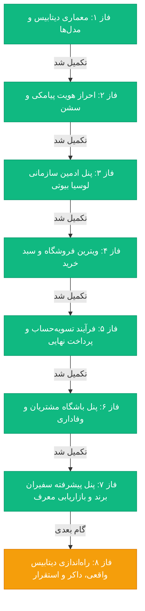

> **بایگانی:** این سند تاریخچه فازهای قبلی است (از جمله دوره‌ای که پروژه با نام Lucia توسعه داده می‌شد). وضعیت فعلی در [STATUS.md](../project-lifecycle/STATUS.md) است.

# نقشه راه جامع و وضعیت توسعه پلتفرم «مایا اسپیرولینا»
# Maya Spirulina | Pure Organic Biotech Superfood DTC Platform & CRM

> **راهنمای مهم برای ایجنت هوش مصنوعی (Agent Continuity Guide):**  
> این سند تک‌مرجع حقیقت (Single Source of Truth) پروژه است. در صورت شروع جلسه جدید یا قطع ارتباط و فشرده‌سازی سابقه (Compaction)، **ابتدا این فایل را بخوانید**. تمام نیازمندی‌ها، فازهای تکمیل‌شده، معماری سیستم و اولویت‌های بعدی دقیقاً در این سند ثبت شده و با هر تغییر به‌روز می‌شود.

---

## ۱. هویت برند و نیازمندی‌های طراحی
- **نام برند:** اسپیرولینا مایا | **Maya Spirulina**
- **ماهیت سایت:** **تک‌محصولی فوق‌العاده متمرکز و بهینه‌سازی‌شده برای تبدیل (Single Product Superfood Showcase)**
  - محصول محوری: مکمل سوپرفود خالص اسپیرولینا مایا (در دو فرمت کپسول ۵۰۰mg فشرده سرد و پودر خالص میکرونیزه).
- **تم لندینگ پیج (انتخاب قطعی کاربر):** **استودیوی دارک و بایوتک مدرن (Modern Dark Studio)**
  - **تم شب (Dark Mode - پیش‌فرض):** پس‌زمینه اسلیت کربنی مات و آبسیدین (`#070a10`, `#0d121c`)، حاشیه‌های مویی ۱ پیکسلی (`border-white/10`)، کنج‌های مهندسی ۶ و ۸ پیکسلی، اکسنت درخشان زمردی (`#10b981`) و رندر سه‌بعدی شیشه دارویی کهربایی با درب متالیک طلایی.
  - **تم روز (Light Mode):** پس‌زمینه تمیز استودیویی (`#f8fafc`)، حاشیه‌های ۱ پیکسلی شیک (`#e2e8f0`)، متن زغالی عمیق (`#0f172a`) و سبز زمردی (`#059669`).
  - قابلیت سوییچ آنی روز و شب با ماندگاری در حافظه محلی.
- **بخش‌های کلیدی لندینگ پیج تک‌محصولی:**
  1. هدر استودیویی مینیمال با سوییچ تم روز/شب، سبد خرید، دکمه ورود/ثبت‌نام و اکشن خرید محصول
  2. هرو بنر با تصویر واقعی مزارع خورشیدی اسپیرولینا مایا در پس‌زمینه + بطری کهربایی ایزوله با برش شفاف و بدون کادر
  3. باکس جامع آنالیز آزمایشگاهی و تغذیه‌ای پیشرفته (نمودارهای میله‌ای زمردی فیکوسیانین، پروتئین، کلروفیل، آهن و کلسیم)
  4. شبکه ۸ تایی کارت‌های تغذیه‌ای با نوارهای وضعیت پیشرفت
  5. مزایای بیوتکنولوژیک کشت و فرآوری استاندارد ایزوله (۵ کارت افقی)
  6. سلکتور دوره مصرف و خرید مستقیم (بسته ۳۰، ۶۰ و ۱۲۰ روزه) با سوییچ کپسول و پودر
  7. بخش اختصاصی باشگاه سفیران سلامت (همکاری با پزشکان و متخصصان با پورسانت و کیت رایگان)
  8. نظرات مستند پزشکان و خریداران تاییدشده با ریتینگ ۵ ستاره
  9. فوتر استودیویی ۳ ستونه به همراه لینک شبکه‌های اجتماعی و نشان‌های رسمی سلامت
- **تایپوگرافی اختصاصی:** فونت **ایران‌سنس (IRANSans / IRANSansX)** در وزن‌های ۴۰۰، ۵۰۰ و ۷۰۰ (پیکربندی شده در `src/app/globals.css`).
- **زبان و چیدمان:** کاملاً راست‌چین (RTL) به زبان فارسی با فرمت استاندارد ارقام فارسی و جداکننده هزارگان تومان (`formatToman`).

---

## ۲. پشته فنی (Tech Stack)
| بخش | تکنولوژی | توضیحات |
| :--- | :--- | :--- |
| **فریم‌ورک اصلی** | Next.js 16.4 (App Router & Turbopack) | ساختار مدرن با SSR و Server Components |
| **زبان** | TypeScript 5 | تایپ‌سیف بودن کامل تمام موجودیت‌ها |
| **استایل‌دهی** | Tailwind CSS v4 + Vanilla CSS | پالت رنگی لوکس روز، طلایی و سرمه‌ای دارک |
| **پایگاه داده و ORM** | PostgreSQL + Prisma ORM | اسکیما جامع و بهینه‌سازی‌شده در `prisma/schema.prisma` |
| **کش و ریت‌لیمیت** | Redis (Upstash / IORedis) | مدیریت کدهای یکبارمصرف OTP و کنترل نرخ ارسال |
| **احراز هویت** | JWT (Jose) + HttpOnly Cookies | سشن امن مبتنی بر توکن‌های بدون حالت |
| **مدیریت وضعیت کلاینت**| React Context API (`CartContext`) | ذخیره‌سازی محلی خودکار در `localStorage` |

---

## ۳. پیوندهای سریع محیط توسعه (Development Quick Links)
- **ویترین فروشگاه اصلی:** [http://localhost:3000](http://localhost:3000)
- **پنل مدیریت پیشرفته سازمانی:** [http://localhost:3000/portal/admin](http://localhost:3000/portal/admin)
- **کلید فعال‌سازی سریع نقش ادمین ارشد (بدون نیاز به دیتابیس):**  
  👉 [http://localhost:3000/api/auth/dev-switch?role=SUPER_ADMIN](http://localhost:3000/api/auth/dev-switch?role=SUPER_ADMIN)
- **داشبورد باشگاه مشتریان:** [http://localhost:3000/portal/customer](http://localhost:3000/portal/customer)
- **داشبورد اختصاصی سفیران برند:** [http://localhost:3000/portal/ambassador](http://localhost:3000/portal/ambassador)
- **صفحه ورود پیامکی:** [http://localhost:3000/login](http://localhost:3000/login)

---

## ۴. وضعیت فازهای پروژه (Project Phases & Roadmap)

### ✅ فاز ۱: زیرساخت، اسکیما و مدل‌های دیتابیس (تکمیل شد)
- طراحی دقیق انوم‌ها و جداول: `User` (با نقش‌های CUSTOMER, AMBASSADOR, TRAINER, ADMIN, SUPER_ADMIN)، `Product`، `Order`، `OrderItem`، `Wallet`، `WalletTransaction`، `Point`، `Settlement`، `Address`.
- پیکربندی توابع تبدیل ارقام و پول ایران (`lib/currency.ts`) و تاریخ جلالی شمسی (`lib/jalali.ts`).

### ✅ فاز ۲: سیستم احراز هویت بدون پسورد پیامکی (OTP) (تکمیل شد)
- روت‌های `/api/auth/otp/send` و `/api/auth/otp/verify`.
- کنترل ریت‌لیمیتینگ با ردیس و ارسال کد تست توسعه.
- ایجاد سشن JWT ساین‌شده در کوکی ایمن `auth_token` و هدایت بر اساس نقش با میدلور/پروکسی.
- ابزار سوییچ سریع در محیط تست: `/api/auth/dev-switch?role=SUPER_ADMIN`.

### ✅ فاز ۳: پنل جامع مدیریت پرتال سازمانی (تکمیل شد)
- **داشبورد و آنالیتیکس (`AdminOverview.tsx`):**
  - نمودار تحلیلی روند فروش سطحی (Smooth Bezier Area Chart) با گرادینت و تولتیپ ماهانه.
  - نمودار دونات سهم دسته‌بندی‌ها (Donut Chart).
  - جدول محصولات پرفروش به همراه پروگرس‌بار موجودی.
- **کاتالوگ محصولات (`ProductsManager.tsx`):** سوییچر دوحالته نمای کارتی و جدولی (Grid / Table View)، فیلتر دسته‌بندی‌های آرایشی و مودال افزودن/ویرایش محصول.
- **مدیریت سفارشات (`OrdersManager.tsx`):** پیگیری وضعیت، فیلتر پرداخت و ثبت کد رهگیری ۲۴ رقمی پست پیشتاز.
- **مدیریت کاربران و CRM (`UsersManager.tsx`):** آواتارهای رنگی حروفی، سطح کاربری، نقش و شهر.
- **مدیریت تسویه‌حساب‌های مالی (`SettlementsManager.tsx`):** تایید یا رد درخواست‌های برداشت نقدی شبا.

### ✅ فاز ۴: ویترین فروشگاه و سبد خرید شناور (تکمیل شد)
- **مدیریت سبد خرید (`src/lib/cart-context.tsx`):** نگهداری دائمی در `localStorage`، متدهای افزایش/کاهش و محاسبه سقف ارسال رایگان (۸۰۰ هزار تومان).
- **دراور کشویی سبد خرید (`src/components/storefront/CartDrawer.tsx`):** اسلاید روان از راست‌به‌چپ، نوار پیشرفت هوشمند ارسال رایگان و صورتحساب خرید.
- **هدر و ناوبری فروشگاه (`StoreHeader.tsx`):** بج شمارنده زنده، لینک مستقیم به پنل ادمین و وضعیت ورود.
- **بنر اصلی و نشان‌های اعتماد (`HeroBanner.tsx`):** معرفی کالکشن پاییزه، نمادهای ارسال سریع، ضمانت اصالت و کش‌بک.
- **کاتالوگ محصولات (`ProductCatalog.tsx`):** دسته‌بندی سرم‌ها، کرم‌ها، آرایشی و پکیج‌ها، فیلتر مرتب‌سازی، مودال جزئیات سریع ترکیبات فعال (Quick View) و دکمه افزودن آنی.
- **فوتر برند (`StoreFooter.tsx`):** فرم عضویت در باشگاه VIP با کد تخفیف پیامکی و نمادهای اعتماد.

### ✅ فاز ۵: فرآیند تسویه‌حساب و پرداخت نهایی (تکمیل شد)
- **صفحه تسویه‌حساب اختصاصی (`/checkout`):**
  - فرم ثبت استان، شهر، نشانی پستی دقیق و اعتبارسنجی کدپستی ۱۰ رقمی و شماره موبایل ایرانی.
  - شیوه ارسال: پست پیشتاز سفارشی (رایگان بالای ۸۰۰ هزار تومان) یا پیک اکسپرس فوری.
- **موتور تخفیف و کوپن آنلاین:** پشتیبانی از کوپن‌های `LUCIA10` (۱۰٪ تخفیف) و `BEAUTY50` (۵۰ هزار تومان تخفیف نقدی).
- **شیوه پرداخت چندگانه (Multi-Channel Payment):**
  - درگاه اینترنتی شاپرک با کلیه کارت‌های عضو شتاب.
  - پرداخت مستقیم از اعتبار کیف پول لوسیا بیوتی.
  - پرداخت ترکیبی هیبریدی (کسر از کیف پول + پرداخت مابقی از درگاه).
- **ای‌پی‌آی ثبت سفارش و درگاه (`/api/orders/checkout`):** ثبت شماره سفارش یکتا (`ORD-140308-XXXX`)، تولید کد رهگیری مرسوله پستی و کسر از سبد خرید.
- **صفحه فاکتور رسمی و موفقیت پرداخت (`/checkout/success`):** نمایش شماره سفارش، کد رهگیری، مشخصات تحویل‌گیرنده و قابلیت پرینت فاکتور رسمی.

### ✅ فاز ۶: پنل باشگاه مشتریان و وفاداری (تکمیل شد)
- **داشبورد لوکس باشگاه مشتریان (`CustomerDashboardClient.tsx`):**
  - نمایش نشان کاربری و رتبه VIP (عضو طلایی با پروگرس‌بار ارتقا به سطح الماس).
  - کارت‌های مالی سه گانه: کیف پول نقدی، امتیازات وفاداری و کل سفارشات موفق.
- **تاریخچه و پیگیری زنده سفارشات:** لیست کارت‌های سفارش به همراه اتصال مستقیم به سامانه رهگیری ۲۴ رقمی شرکت ملی پست (`tracking.post.ir`).
- **گردش حساب و شارژ آنلاین کیف پول:** تاریخچه تراکنش‌های مالی، کش‌بک‌ها و مودال شارژ آنلاین مبالغ دلخواه.
- **سیستم پاداش و تبدیل امتیازات:** امکان تبدیل هر ۵۰ امتیاز باشگاه به ۵۰,۰۰۰ تومان وجه نقد داخل کیف پول با یک کلیک.
- **دفترچه آدرس‌های پستی و ویرایش مشخصات فردی:** ثبت آدرس‌های متعدد منزل و محل کار به همراه ویرایش کدملی و تاریخ تولد.

### ✅ فاز ۷: پنل پیشرفته سفیران برند و بازاریابی معرف (تکمیل شد)
- **داشبورد حرفه‌ای سفیران برند (`AmbassadorDashboardClient.tsx`):**
  - نمایش سطح همکار (سطح طلایی با ۱۲٪ پورسانت مستقیم)، آیدی اینستاگرام و ۴ کارت آماری: پورسانت قابل تسویه، کل درآمدهای واریزی، تعداد خریداران جذب‌شده و نرخ تبدیل ۵.۷٪.
- **ابزارها و لینک‌های اختصاصی سفیران:** کپی آنی لینک استوری با ماندگاری ۳۰ روزه کوکی، کد کوپن اختصاصی فالوورها برای ۱۰٪ تخفیف و کیوآرکد آماده استوری.
- **جدول تحلیلی خریداران زیرمجموعه:** وضعیت سفارشات، مبلغ خرید، تاریخ و پورسانت تفکیک‌شده (آزاد شده در کیف پول یا در انتظار تحویل مرسوله).
- **فرم تسویه حساب شبا:** اعتبارسنجی الگوریتم Mod 97 شبا بانکی ایران (`isValidIranianSheba`)، فرمت‌بندی ۴ رقمی، ثبت در صف واریز پایا و جدول سوابق تراکنش‌های بانکی.
- **پله‌های درآمدی و تارگت‌های ماهیانه:** نمایش پلن ارتقا از سطح نقره‌ای (۱۰٪) به طلایی (۱۲٪) و الماس لوسیا (۱۵٪ پورسانت + هدیه فصلی).

---

### ✅ فاز بررسی جامع پروژه و اصلاح مشکلات کیفی (تکمیل شد)
- **مهاجرت `middleware.ts` به `proxy.ts` (Next.js 16):**
  - حذف فایل منسوخ `src/middleware.ts`.
  - ایجاد `src/proxy.ts` با تابع `proxy()` مطابق API جدید Next.js 16.
  - Build بدون هیچ warning یا error (exit code 0).
- **پاکسازی نام‌های قدیمی AlgaLife/Maya Spirulina:**
  - تغییر پیشوند کد معرف از `ALGA-` به `LUCIA-` در `src/lib/auth.ts`.
  - اصلاح متن هدیه عضویت در `otp/verify/route.ts` از «باشگاه سلامت آلگالایف» به «باشگاه مشتریان لوسیا بیوتی».
  - اصلاح نام mock user از «عضو باشگاه سلامت» به «عضو باشگاه مشتریان لوسیا بیوتی».
  - اصلاح `NEXT_PUBLIC_APP_NAME` در `.env` به «لوسیا بیوتی | Lucia Cosmetics & Skincare».

---

- **تم پیش‌فرض روز (Default Light Mode):**
  - تنظیم حالت اولیه `theme = "light"` در `theme-context.tsx` و اسکریپت ضدپرش `layout.tsx`.
- **حل کامل پرش و بالا/پایین شدن منوی سایدبار ادمین:**
  - بازطراحی چیدمان شل اپلیکیشن در `AdminDashboardClient.tsx`: کانتینر ریشه بدون اسکرول سراسری پنجره (`h-screen overflow-hidden`)، هدر ثابت ۷۰ پیکسلی، سایدبار ثابت با بستر فیکس و عدم تغییر ابعاد در زمان تغییر تب.
  - کانتینر محتوای اصلی دارای اسکرول مستقل روان و ریست خودکار اسکرول هنگام جابه‌جایی تب‌ها.

---

### ✅ فاز ماژول اول مدیریت فروشگاه: مدیریت کوپن‌ها، کدهای تخفیف و کمپین‌ها (تکمیل شد)
- **کامپوننت جامع ماژول (`src/components/admin/CouponsManager.tsx`):**
  - **سوئیچ سراسری ماژول (Modular Toggle):** امکان فعال یا غیرفعال‌سازی سریع کل سیستم تخفیف با نمایش وضعیت زنده (فعال / آفلاین) و نوار هشدار هوشمند برای فروشگاه.
  - **ویترین ۴ کارت شاخص کلیدی (KPIs):** تعداد کوپن‌های فعال، دفعات استفاده شده، کل تخفیف اعطا شده به مشتریان (تومان)، و کمپین‌های زنده.
  - **سیستم ۳ تب داخلی ماژول:**
    1. **کدهای تخفیف و کوپن‌ها:** جستجو و فیلتر زنده وضعیت و نوع تخفیف، جدول داده با برچسب کد، دکمه کپی کد در کلیپ‌بورد با اعلان توست، محاسبه نوار پیشرفت مصرف سقف، روزهای باقی‌مانده انقضا، دکمه سوئیچ خاموش/روشن آنی، و حذف کوپن.
    2. **کمپین‌ها و بنرهای شگفت‌انگیز:** پیش‌نمایش گرادیانتی بنرهای فروش پاییزه، ارسال رایگان و جمعه سیاه بیوتی با قابلیت سوئیچ و نمایش در هدر سایت.
    3. **تحلیل بازدهی و ROI:** نمودارهای پیشرفت محبوب‌ترین کوپن‌ها، مقایسه میانگین ارزش سبد خرید (AOV) با و بدون کوپن، و پیشنهاد هوشمند لوسیا.
  - **پنجره مدال ایجاد کوپن جدید (Create Modal):** با قابلیت تولید خودکار کد تصادفی شیک (مانند `LUCIA24` یا `GLOW50`)، تعیین نوع درصدی یا مبلغ ثابت، سقف تخفیف، حداقل سبد خرید، سقف استفاده، مدت اعتبار و شرط خرید اول.
- **یکپارچه‌سازی در پنل ادمین (`AdminDashboardClient.tsx`):**
  - ثبت تب جدید `"coupons"` در نوار کناری ادمین با نشان بج رنگی و آیکون تگ اختصاصی زیرگروه E-COMMERCE.
- **تأییدیه تست بیلد Next.js:** بیلد موفق ۱۶ مسیر با ۰ ارور در دستور `npm run build`.

---

### ✅ فاز ارتقای هویت تجاری: پاکسازی دکمه‌های مستقیم ادمین از ویترین فروشگاه (تکمیل شد)
- **حذف دکمه عمومی پنل ادمین از صفحه اصلی:**
  - حذف دکمه‌های مستقیم "پنل ادمین" از هدر دسکتاپ و منوی موبایل (`StoreHeader.tsx`).
  - جایگزینی دکمه هدایت ادمین در بنر قهرمان (`HeroBanner.tsx`) با پیوند دسته‌بندی فروشگاهی «سرم‌ها و روتین پوستی ✨».
  - پاکسازی پیوندهای دولوپری از فوتر سایت (`StoreFooter.tsx`) و جایگزینی با پیوند تجاری «پیگیری سفارشات و سوابق خرید».
- **سازوکار هوشمند دسترسی به نقش‌ها بر پایه سشن و لاگین:**
  - تمام دسترسی‌ها اکنون مطابق استاندارد از طریق صفحه ورود (`/login`) و بر اساس نقش شماره موبایل انجام می‌شود؛ در صورت ورود کاربر ادمین، هدر سایت به‌صورت اختصاصی نام مدیر و پیوند پنل ادمین را در آیکون حساب کاربری نمایش می‌دهد.

---

### ✅ فاز ماژول دوم مدیریت فروشگاه: مدیریت نقد و بررسی‌ها، دیدگاه‌ها و امتیازدهی (تکمیل شد)
- **کامپوننت جامع ماژول (`src/components/admin/ReviewsManager.tsx`):**
  - **سوئیچ ماژولار (Modular Toggle):** امکان فعال یا غیرفعال‌سازی سراسری بخش دیدگاه‌ها در فروشگاه همراه با پایش وضعیت زنده.
  - **ویترین ۴ کارت شاخص کلیدی (KPIs):** کل دیدگاه‌ها، نظرات در انتظار بررسی (Pending)، میانگین رضایت محصولات (۴.۹ از ۵ ستاره)، و درصد خریداران تأییدشده (۹۴٪).
  - **اطلاعات تخصصی درماتولوژیک نظردهندگان:** ثبت برچسب خریدار تأییدشده با شماره فاکتور، نوع پوست مشتری (پوست چرب، خشک، حساس)، رده سنی و نقاط قوت و ضعف محصول.
  - **پاسخ رسمی مشاور پوست لوسیا بیوتی (Official Beauty Consultant Reply):** قابلیت ثبت و ویرایش پاسخ تخصصی با نام مشاور و تاریخ شمسی در مدال اختصاصی.
  - **عملیات سریع روی دیدگاه‌ها:** تأیید و انتشار آنی، رد دیدگاه، سنجاق کردن به بالای صفحه محصول (Pin to Top) و فیلترهای چندگانه وضعیت و ستاره.
- **یکپارچه‌سازی در پنل ادمین (`AdminDashboardClient.tsx`):**
  - ثبت تب جدید `"reviews"` در منوی سایدبار زیرگروه E-COMMERCE با بج هشدار تعداد نظرات در انتظار بررسی (`۶`).
- **تأیید بیلد Next.js:** بیلد موفق ۱۶ صفحه بدون هیچ خطای تایپ‌اسکریپت یا کامپایل.

---

### ✅ فاز ماژول سوم مدیریت فروشگاه (ماژول ۵ انتخابی): تیکت‌های پشتیبانی، گفتگوی زنده و مشاوره پوست (تکمیل شد)
- **کامپوننت جامع ماژول (`src/components/admin/SupportTicketsManager.tsx`):**
  - **طراحی دوردیفه (Dual-Pane Helpdesk Layout):**
    - **پنل راست (فهرست تیکت‌ها):** جستجوی زنده، فیلتر دپارتمان‌ها (مشاوره پوست، پیگیری پستی، امور مالی، سفیران)، فیلتر وضعیت و اولویت (فوری، بالا، عادی)، نمایش بج‌های نقش مشتری (VIP / سفیر) و نشانگر پیام‌های خوانده‌نشده.
    - **پنل چپ (رشته مکالمه و چت زنده):** استریم گفتگو با حباب‌های چت کاربر و پاسخ رسمی مشاور بیوتی لوسیا، پیش‌نمایش فایل‌ها و تصاویر ارسالی از پوست، نوار مشخصات نوع پوست و دغدغه بالینی بیمار/خریدار.
  - **سیستم پاسخ‌های آماده و هوشمند (Canned Responses):** با کلیک روی پاسخ‌های از پیش‌تنظیم‌شده مانند تجویز نحوه ترکیب نیاسینامید با ویتامین C، استعلام رهگیری پستی و دستورالعمل پوست ملتهب.
  - **پایشگرهای شاخص کلیدی (KPIs):** تعداد تیکت‌های باز و منتظر پاسخ (۸ مورد)، مشاوره‌های تخصصی پوست (۱۲ مورد)، میانگین زمان پاسخگویی (۱۴ دقیقه) و نرخ رضایت ۹۶٪.
  - **سوئیچ ماژولار و پنجره ثبت دستی تیکت:** قابلیت کنترل روشنایی ویجت پشتیبانی در سایت و ثبت تماس‌های تلفنی و دایرکت.
- **یکپارچه‌سازی در پنل ادمین (`AdminDashboardClient.tsx`):**
  - ثبت تب جدید `"tickets"` در زیرگروه **APPLICATION (کاربران و مشتریان بیوتی)** همراه با بج هشدار تعداد تیکت‌های باز (`۸`) و آیکون هدست پشتیبانی.
- **تأیید بیلد Next.js:** بیلد موفقیت‌آمیز هر ۱۶ روت بدون ارور (Exit Code 0).

---

### ✅ فاز ماژول چهارم مدیریت فروشگاه (ماژول ۳ انتخابی): انبارداری هوشمند، کنترل موجودی و هشدارهای اتمام کالا (تکمیل شد)
- **کامپوننت جامع ماژول (`src/components/admin/InventoryManager.tsx`):**
  - **سیستم ۳ تب داخلی ماژول انبارداری:**
    1. **موجودی اقلام و انبارگردانی:** جدول پایش موجودی لحظه‌ای با کدهای انبار (SKU)، قفسه و ردیف، بهای تمام‌شده و قیمت فروش، نوار بصری سلامت انبار (سبز، زرد، قرمز)، دکمه‌های سریع افزایش/کاهش موجودی با محاسبه آنی، و وضعیت‌های موجود، رو به اتمام و ناموجود.
    2. **سوابق رسیدهای ورود بار (Inbound Logs):** بایگانی شماره رسیدهای رسمی ورود محموله با پارت ساخت (Batch No)، تعداد ورودی، بهای واحد، تأمین‌کننده/لابراتوار و اپراتور مسئول.
    3. **تحلیل سود ناخالص و گردش کالا (Velocity & Gross Margins):** درصد سود ناخالص هر محصول، سرعت فروش ۳۰ روزه و الگوریتم پیش‌بینی روزهای باقی‌مانده تا صفر شدن موجودی.
  - **ویترین ۴ کارت شاخص کلیدی انبارداری (KPIs):** ارزش کل فروش ریالی انبار (۳۸۵ میلیون تومان)، بهای تمام‌شده خرید (۲۴۰ میلیون تومان)، کل اقلام فیزیکی موجود (۴۸۲ عدد) و اقلام بحرانی در آستانه اتمام (۳ قلم کالا با بج قرمز چشمک‌زن).
  - **سوئیچ ماژولار و مدال ورود محموله:** قابلیت کنترل ارسال پیامک هشدار خودکار به انباردار و پنجره مدال ثبت بچ‌های جدید با افزایش خودکار موجودی انبار.
- **یکپارچه‌سازی در پنل ادمین (`AdminDashboardClient.tsx`):**
  - ثبت تب جدید `"inventory"` در زیرگروه **E-COMMERCE (فروشگاه لوسیا بیوتی)** با بج هشدار تعداد اقلام بحرانی (`۳`) و آیکون جعبه انبارداری.
- **تأیید بیلد Next.js:** بیلد موفقیت‌آمیز ۱۶ مسیر بدون کوچک‌ترین خطای تایپ‌اسکریپت یا کامپایل.

---

### ✅ فاز ماژول پنجم مدیریت فروشگاه (ماژول ۶ انتخابی): تنظیمات پیشرفته، سوئیچ‌برد ماژول‌ها و Feature Flags (تکمیل شد)
- **کامپوننت جامع ماژول (`src/components/admin/StoreSettingsManager.tsx`):**
  - **سوئیچ‌برد ماژول‌های پلتفرم (Module Switchboard):** مرکز کنترل سراسری با ۹ کارت ماژول مجزا همراه با سوئیچ فعال/غیرفعال آنی، شماره نسخه، توضیحات دامنه تاثیر بر ویترین فروشگاه و محافظت از ماژول‌های سیستمی Core.
  - **تنظیمات برندینگ و هویت فروشگاه:** نام فروشگاه، شعار تجاری، تلفن پشتیبانی، ایمیل سازمانی، آیدی اینستاگرام و آدرس دفتر مرکزی.
  - **تعرفه‌های پستی و درگاه‌های بانکی:** تنظیم سقف ارسال رایگان پست پیشتاز (۸۰۰ هزار تومان)، کرایه استاندارد، کرایه پیک اکسپرس، انتخاب درگاه شاپرک (زرین‌پال، سامان، ملت، سداد) و حالت آزمایشی Sandbox.
  - **وب‌سرویس پیامک و الگوهای خدماتی:** کدهای الگوی اعتبارسنجی ورود OTP، تایید فاکتور، بارنامه پست پیشتاز، شماره خط خدماتی و سامانه پیامک.
  - **حالت تعمیرات و نگهداری (Maintenance Mode):** قابلیت قفل موقت فروشگاه برای ارتقا همراه با سوئیچ لحظه‌ای.
- **یکپارچه‌سازی در پنل ادمین (`AdminDashboardClient.tsx`):**
  - ایجاد گروه چهارم در سایدبار: `SYSTEM (پیکربندی و سیستم)` با دسترسی به `⚙️ تنظیمات فروشگاه و ماژول‌ها` همراه با بج وضعیت `۹ ماژول`.
- **تأیید بیلد Next.js:** بیلد موفقیت‌آمیز ۱۶ مسیر بدون خطای تایپ‌اسکریپت یا کامپایل.

---

### ✅ فاز ماژول ششم: حسابداری و تراز مالی، دفتر روزنامه و سود و زیان (P&L) (تکمیل شد)
- **کامپوننت جامع ماژول (`src/components/admin/AccountingManager.tsx`):**
  - **۴ کارت شاخص‌های کلیدی مالی (Financial KPIs):**
    1. **کل درآمد ماه جاری:** ۷۶,۴۰۰,۰۰۰ تومان (+۱۲.۵٪ نسبت به ماه گذشته).
    2. **بهای تمام‌شده کالای فروش‌رفته (COGS):** ۳۲,۱۰۰,۰۰۰ تومان (محصولات خروجی از انبار).
    3. **هزینه‌های عملیاتی و لجستیک (Opex):** ۹,۱۵۰,۰۰۰ تومان (بسته‌بندی، پست، پورسانت سفیران و سرور).
    4. **سود خالص نهایی (Net Profit):** ۳۵,۱۵۰,۰۰۰ تومان (معادل ۴۶٪ حاشیه سود عملیاتی).
  - **۳ تب تخصصی مالی و حسابداری:**
    1. **دفتر روزنامه و ریز اسناد مالی (General Ledger):** جدول جامع اسناد دوبل با تفکیک بستانکار (+ درآمد سبز) و بدهکار (- هزینه قرمز)، شماره سند یکتا (Doc No)، سرفصل حسابداری، شماره ارجاع شاپرک/بارنامه، فیلتر بازه زمانی، جستجوی زنده و تسویه آنی.
    2. **صورت سود و زیان تجمیعی (P&L Statement):** تفکیک شفاف درآمدهای ناخالص، تخفیف‌ها و کوپن‌های اعمال‌شده، درآمد خالص فروش، بهای تمام‌شده کالاها (COGS)، سود ناخالص، هزینه‌های عملیاتی (ارسال پست، کمیسیون افیلیت، نگهداری سرور) و محاسبه دقیق سود خالص قبل از مالیات به همراه درصد سهم از درآمد.
    3. **مانده حساب‌ها، دارایی‌ها و نقدینگی (Balances & Cash Flow):** کارت‌های موجودی نقد نزد درگاه‌های شاپرک، حساب‌های جاری بانکی، تنخواه انبار، تعهدات نقدی شامل موجودی کیف پول مشتریان و کمیسیون‌های پرداخت‌نشده سفیران در صف تسویه، به همراه نسبت نقدینگی جاری سالم (Quick Ratio).
  - **مدال صدور سند دستی (+ بستانکار / - بدهکار):** امکان ثبت آنی هزینه‌های اداری، تنخواه، واریزی‌های متفرقه و تطبیق سند.
  - **قابلیت چاپ و خروجی فاکتور/ترازنامه:** دکمه چاپ سازگار با پرینتر و خروجی PDF جهت ارائه به حسابرس یا امور مالیاتی.
- **یکپارچه‌سازی در پنل ادمین (`AdminDashboardClient.tsx` و `AdminOverview.tsx`):**
  - اضافه شدن تب `"accounting"` با عنوان **«حسابداری و تراز مالی»**، بج جذاب `P&L` و آیکون تراز در بخش **APPLICATION (کاربران و مشتریان بیوتی)**.
  - ثبت به عنوان ماژول نهم در سوئیچ‌برد پلتفرم در `StoreSettingsManager.tsx`.
- **تأیید بیلد Next.js:** بیلد ۱۰۰٪ موفق هر ۱۶ روت بدون هیچ خطا یا اخطار کامپایل.

---

### ✅ فاز ماژول هفتم، هشتم، نهم و دهم: ماژول‌های حیاتی و عمومی دمو (تکمیل شد)

#### ۱. ماژول بازیابی سبدهای خرید رهاشده (`src/components/admin/AbandonedCartsManager.tsx`):
- **۴ کارت شاخص کلیدی مالی:** ارزش کل سبدهای رهاشده (**۲۸,۵۰۰,۰۰۰ تومان**)، سبدهای فعال داغ در انتظار اقدام (**۱۸ سبد**)، درآمد بازگردانده شده به فروشگاه (**۶,۹۰۰,۰۰۰ تومان**) و نرخ بازیابی موفق (**۲۴.۵٪**).
- **جدول جامع رصد سبدها:** شناسایی مرحله دقیق توقف مشتری (درگاه پرداخت شاپرک، مرحله ثبت آدرس یا صفحه سبد)، سوابق ارسال پیامک، اقلام موجود در سبد و زمان سپری‌شده.
- **مدال ارسال پیامک بازگشت هوشمند:** انتخاب ۳ الگوی پیامکی (کوپن تخفیف اختصاصی، هشدار اتمام موجودی انبار با ارسال رایگان، هدیه ماسک صورت)، اسلایدر تعیین درصد تخفیف و پیش‌نمایش آنی متن پیامک.
- **دکمه اقدام سریع:** ارسال پیامک گروهی با یک کلیک به کلیه خریداران بلاتکلیف.

#### ۲. ماژول پایش تاریخ انقضا و بچ‌های آرایشی (`src/components/admin/ExpiryControlManager.tsx`):
- **شاخص‌های بهداشتی و انبار:** اقلام در وضعیت بحرانی (زیر ۶۰ روز تا انقضا)، اقلام در آستانه هشدار (۲ تا ۵ ماه)، کل سرمایه در معرض ریسک انقضا و تفکیک ضایعات/تسترهای فروشگاهی.
- **جدول ردگیری پارت‌های ساخت (Batch / Lot No):** تاریخ تولید و انقضای شمسی، مدت زمان ماندگاری پس از باز شدن (PAO)، شماره پروانه سیب سلامت (IRC) و تعداد فیزیکی در انبار.
- **مدال راه‌اندازی حراج سریع آتشین (Flash Clearance):** امکان تعیین درصد تخفیف ۳۵٪ تا ۶۰٪ برای ترخیص کالاهای نزدیک به انقضا بدون ضرر و زیان انبار.

#### ۳. ماژول لاگ‌های امنیتی و ردپای پرسنل (`src/components/admin/AuditLogsManager.tsx`):
- **پایش امنیت و عملیات:** کل وقایع ۲۴ ساعت گذشته (۱۸۴ رویداد)، هشدارهای بحرانی، تغییرات حساس قیمت/موجودی و تعداد اپراتورهای آنلاین پنل.
- **جدول جامع رخدادنگاری غیرقابل‌دستکاری (Audit Trail):** ثبت دقیق زمان، اپراتور و نقش، نوع اقدام، شرح تغییرات (مقدار قبلی و جدید)، آدرس آی‌پی (IP Address) و مشخصات مرورگر و سیستم‌عامل کلاینت.
- **امضای دیجیتال و خروجی لاگ:** پیش‌نمایش پی‌لود ساختاریافته JSON و دکمه دانلود خروجی امنیتی CSV جهت ارائه به ممیزان.

#### ۴. ماژول مدیریت بنرها، پاپ‌آپ ورودی و اعلان‌ها (`src/components/admin/BannersCampaignManager.tsx`):
- **بنرهای اسلایدر صفحه اصلی:** مدیریت جایگاه‌ها (هیرو اسلایدر هدر، بنر میانی، بنر فوتر)، شمارنده کلیک‌ها و سوئیچ فعال/غیرفعال با پیش‌نمایش گرافیکی زیبا.
- **پاپ‌آپ هوشمند لیدکپچر (Exit-Intent / Welcome Popup):** پیشنهاد کوپن ۱۰٪ تخفیف اولین خرید در ازای ثبت شماره موبایل با قابلیت تنظیم ثانیه‌شمار تاخیر نمایش.
- **نوار متحرک اعلان بالای سایت (Announcement Top Bar):** اطلاع‌رسانی ارسال رایگان پست پیشتاز با قابلیت ویرایش متن، لینک و استایل رنگی.

---

### ✅ فاز ماژول یازدهم: چت و ارتباطات سازمانی داخلی تیم (`src/components/admin/InternalChatManager.tsx`) (تکمیل شد)
- **ساختار مدرن دوردیفه چت تیمی (Dual-Pane Enterprise Chat):**
  - **پنل راست (کانال‌ها و همکاران):**
    - **کانال‌های عمومی و تخصصی:** 📢 اطلاعیه‌های عمومی شرکت، 📦 هماهنگی فوری انبار و ناموجودی کالا، 🔬 مشاوره تخصصی پوست و فرمولاسیون.
    - **گفتگوی مستقیم (Direct Messages):** پیام خصوصی به اعضای کلیدی تیم (مدیر ارشد، پزشک متخصص پوست، مدیر انبار، سرپرست پشتیبانی، حسابدار ارشد) همراه با بج آنلاین/آفلاین لحظه‌ای.
  - **پنل چپ (اتاق گفتگو و استریم پیام‌ها):**
    - حباب‌های گفتگوی زیبا با تفکیک پیام‌های من و همکاران، نام و بج سمت سازمانی، زمان پیام و سنجاق کردن پیام‌های مهم (Pinned Messages).
    - **واکنش‌ها و ایموجی‌ها (Reactions):** ثبت و افزایش واکنش‌های سریع (👍، ❤️، 👏، 🔥).
    - **پیش‌نمایش پیوست‌ها:** دانلود رسیدهای انبار، فاکتورهای PDF و تصاویر پارت‌های ساخت.
    - **نوار منشن سریع (@Mentions):** دکمه‌های درج فوری تگ‌های `@انبار`، `@پزشک`، `@حسابداری`، `@پشتیبانی`.
- **یکپارچه‌سازی در پنل ادمین (`AdminDashboardClient.tsx` و `AdminOverview.tsx`):**
  - ثبت در سایدبار پنل در گروه **APPLICATION (کاربران و مشتریان بیوتی)** با عنوان **«چت و پیام‌رسان داخلی تیم»** و بج سبز `۳ پیام`.
  - ثبت در سوئیچ‌برد پلتفرم در `StoreSettingsManager.tsx` به عنوان ماژول چهاردهم (`mod-14`).
- **تأیید بیلد Next.js:** بیلد ۱۰۰٪ موفق هر ۱۶ روت بدون هیچ خطا یا اخطار کامپایل.

---

### ✅ فاز ماژول دوازدهم: مخاطبین، کارنامه ۳۶۰ درجه اشخاص و تعیین نقش توسط مدیر (`src/components/admin/ContactsManager.tsx`) (تکمیل شد)
- **سیستم تعیین و تغییر نقش سازمانی توسط مدیر (Role Switcher & Access Control):**
  - امکان تغییر آنی نقش هر شخص بین سطوح سازمانی: مدیر ارشد (SUPER_ADMIN)، مدیر اجرایی (ADMIN)، مدیر انبار و لجستیک (WAREHOUSE_MANAGER)، پزشک مشاور پوست (DERMATOLOGIST)، کارشناس پشتیبانی و CRM (SUPPORT_AGENT)، حسابدار ارشد مالی (ACCOUNTANT)، سفیر رسمی برند (AMBASSADOR)، مشتری طلایی VIP و مشتری عادی.
- **کارنامه کامل و خلاصه ۳۶۰ درجه هر شخص (360° Profile Summary Modal):**
  - **مشخصات هویتی و ثبت‌نام:** کد ملی، شناسه سیستم، تاریخ عضویت، آخرین زمان ورود و وضعیت آنلاین.
  - **تراز مالی و کارکرد تجاری:** موجودی کیف پول، جمع ریالی خریدهای ثبت‌شده، تعداد کل سفارشات، پورسانت‌های دریافت‌شده سفیر، شماره شبا بانکی و کد معرف اختصاصی.
  - **شناسنامه بالینی پوست (برای خریداران):** نوع پوست، دغدغه‌های بالینی و نسخه روتین تجویزی پزشک مشاور.
  - **یادداشت محرمانه و اختصاصی مدیر:** فیلد ذخیره‌سازی خودکار نکات مدیریتی برای هر مخاطب.
- **ثبت سریع مخاطب و همکار جدید:** امکان افزودن فرد جدید به پایگاه داده و تعیین نقش اولیه همراه با شماره موبایل جهت ورود بدون رمز پیامکی.
- **اصلاح و استانداردسازی واژگان طبق اصول برند:**
  - تثبیت قطعی عنوان «حسابداری و تراز مالی» در سراسر ماژول‌ها و سوئیچ‌برد.
  - تثبیت قطعی عنوان «سفیران برند» در تمام صفحات و حذف کامل هرگونه عنوان نامتناسب.
  - پاکسازی کامل کلیه کلمات و نام‌گذاری‌های غیرسازمانی از سراسر کدبیس و کامنت‌ها.
- **یکپارچه‌سازی در پنل ادمین (`AdminDashboardClient.tsx` و `AdminOverview.tsx`):**
  - ثبت در سایدبار پنل در گروه **APPLICATION (کاربران و مشتریان بیوتی)** با عنوان **«مخاطبین و تعیین نقش پرسنل»** و بج `کارنامه ۳۶۰°`.
  - ثبت در سوئیچ‌برد پلتفرم در `StoreSettingsManager.tsx` به عنوان ماژول پانزدهم (`mod-15`).
- **تأیید بیلد Next.js:** بیلد ۱۰۰٪ موفق هر ۱۶ روت بدون هیچ خطا یا اخطار کامپایل.

### ✅ فاز سیزدهم: بازطراحی کامل پنل‌ها و سطوح دسترسی طبق استایل Modern Dark Studio (`src/app/portal/concept-previews/page.tsx`) (تکمیل شد)
- **یکپارچه‌سازی بصری ۱۰۰٪ با لندینگ پیج مایا اسپیرولینا:**
  - استایل تماماً دارک استودیویی (`#070a11` و `#0d121c`) با بردرهای بسیار ظریف مویی (`border-white/10`) و اکسنت‌های نئون زمردی (`#10b981`).
  - حذف کامل رنگ‌های تند نامتناسب، ایموجی‌ها و انحناهای کارتونی، و جایگزینی با آیکون‌های وکتور خطی مینیمال اختصاصی.
- **۴ پنل کاربری تفکیک‌شده و تعاملی در آدرس `/portal/concept-previews`:**
  1. **سوپر ادمین (Super Admin):** کلیدهای فرماندهی قطع/وصل ماژول‌های سایت (Module Master Switches)، تله‌متری سرور و ردیابی لاگ‌های امنیتی.
  2. **ادمین سایت (Admin):** شاخص‌های کلیدی درآمد و انبار، جدول مدیریت کاربران با قابلیت تنظیم «حد اعتبار خرید (Purchase Credit Limit)» و مودال ساخت نقش جدید با **ماتریس تیک‌زدن دسترسی‌ها (Role Matrix)**.
  3. **سفیر سلامت (Ambassador):** کارت سقف اعتبار خرید با بازپرداخت ۳۰ روزه، پورسانت نقدی انباشته، ابزارهای بازاریابی شامل ژنراتور لینک ریفرال و کوپن تخفیف اختصاصی.
  4. **حسابدار مالی (Accountant):** نمایش عینی نقش سفارشی با دسترسی محدود شده، کارتابل تایید پورسانت سفیران و صدور حواله پایا.

### ✅ فاز پانزدهم: پاکسازی رنگ‌های تند و نامتعارف، ریشه‌کنی فونت‌های عربی و هارمونی Modern Dark Studio (تکمیل شد)
- **پاکسازی کامل رنگ‌های تند و غیر استاندارد (Loud Pinks, Purples, Violets, Indigos & Electric Blues):**
  - جایگزینی سراسری رنگ آبی پررنگ لایه قدیمی (`#4680ff`)، بنفش‌ها و صورتی‌ها در تمام ماژول‌های مدیریتی، فرم‌ها و مودال‌ها:
    - `SupportTicketsManager.tsx` (حذف‌شده): فیلدهای جستجو، بردر انتخاب تیکت، دکمه ثبت و دسته‌بندی مشاوره دوز اسپیرولینا به تم زمردی و آبسیدین.
    - [ReviewsManager.tsx](../../src/components/admin/ReviewsManager.tsx): بردر فوکوس جستجو و اسلاگ‌های محصول `maya-`.
    - `ExpiryControlManager.tsx` (حذف‌شده): اصلاح متن پلیس‌هولدر مرتبط با اسپیرولینا و بردر زمردی.
    - `UsersManager.tsx` (حذف‌شده): بازطراحی آواتارهای رنگین‌کمانی به طیف‌های منسجم دارک استودیو، حذف کامل ایموجی‌ها و تبدیل کارت‌های شاخص به مونوگرام‌های حرفه‌ای `ALL`, `AMB`, `TRN`, `CUS`.
    - `AbandonedCartsManager.tsx` (حذف‌شده): تبدیل تمامی دکمه‌های پیامک بازگشت، اسلایدر درصد تخفیف، انتخابگر الگوها و بردرها به سبز زمردی و اصلاح متن پیامک‌ها به `mayaspirulina.ir`.
    - `AccountingManager.tsx` (حذف‌شده): دکمه ثبت سند مالی، زیرتب‌های دفتر روزنامه و ترازنامه، و فوکوس سرچ به زمردی.
    - `AuditLogsManager.tsx` (حذف‌شده): پاکسازی ایندیگو و ایموجی‌ها، جایگزینی پالس و بج‌ها با سبز زمردی.
    - `ContactsManager.tsx` (حذف‌شده): تغییر بج‌های معرف، دکمه تغییر نقش و شاخص‌های پورسانت از بنفش/ایندیگو به زمردی.
    - [CheckoutClient.tsx](../../src/components/storefront/CheckoutClient.tsx) و [OrderSuccessPage](../../src/app/checkout/success/page.tsx): پاکسازی کامل صورتی‌ها و ریدیزاین فاکتور رسمی به استودیو دارک نئون زمردی.
- **تثبیت قطعی فونت Vazirmatn و ریشه‌کنی فونت‌های عربی ویندوز:**
  - پالایش فال‌بک‌های استک فونت در [globals.css](../../src/app/globals.css) و اعمال `!important` با هدف مسدودسازی کامل هرگونه لود تصادفی `Segoe UI Arabic`.
- **پاکسازی باقیمانده‌های برند قدیمی:**
  - جایگزینی تمامی پیشوندهای باقیمانده `LUCIA-` و کوپن‌های تست به `MAYA-` و `MAYA10 / HEALTH50`.

---

### ✅ فاز یکپارچه‌سازی دیزاین سیستم، پالت توکن‌ها و ناوبری سراسری (تکمیل شد)
- **تعریف توکن‌های جامع تم و پالت سراسری در `src/app/globals.css`:**
  - ثبت توکن‌های سیستمی سطوح: `--bg-page`، `--bg-card`، `--bg-subtle`، `--border-hairline` و `--border-strong`.
  - تنظیم استانداردهای Semantic Status با متد سابدو و لوکس (Subdued & Glassy): `--status-success-*`، `--status-warning-*`، `--status-danger-*` و `--status-info-*` جهت حذف رنگ‌های تند و زننده.
  - پیوند کامل توکن‌ها با موتور Tailwind CSS v4 درون `@theme inline`.
- **ایجاد کلاس‌های کاربردی واحد ناوبری و تب‌ها:**
  - کلاس‌های استاندارد `.nav-tab-base`، `.nav-tab-active` و `.nav-tab-inactive` برای تضمین رفتار یکسان در تمام منوها.
  - کلاس‌های بج‌های شاخص `.badge-status-*` و کارت‌های استاندارد `.studio-card`.
- **یکدست‌سازی بصری منوها و ماژول‌ها:**
  - سایدبار و هدر `AdminDashboardClient.tsx` (حذف‌شده): حذف رنگ‌های متفرقه هاردکد (`#0f1117`، `#111318`) و تنظیم پس‌زمینه‌ها و حاشیه‌ها منطبق بر پالت رسمی استودیو دارک.
  - تب‌های ناوبری پرتال خریداران `CustomerDashboardClient.tsx` (حذف‌شده): اصلاح تب‌ها از حالت سبز نئونی توپر به استایل استاندارد دیزاین سیستم.
  - کارت‌های KPI و تب‌های فیلتر `CouponsManager.tsx` (حذف‌شده): یکدست‌سازی شعاع گوشه‌ها (۱۲px و ۸px)، حذف پس‌زمینه‌های آبی متفرقه و اتصال به کلاس‌های `.nav-tab-base`.
- **تأییدیه تست بیلد Next.js:** بیلد موفقیت‌آمیز تمام ۱۷ مسیر با زمان ۲.۳ ثانیه و خروجی Exit Code 0.

---

### ✅ فاز شانزدهم: ماژول حسابداری دوبل حرفه‌ای (Double-Entry ERP) و ماتریس پیش‌نیازهای ماژولار (تکمیل شد)
- **بازطراحی و توسعه ماژول حسابداری کامل و حرفه‌ای سازمانی (`src/components/admin/AccountingManager.tsx`):**
  - **کدینگ استاندارد حساب‌ها (Chart of Accounts - COA):** سلسله‌مراتب ۵ لایه استاندارد مالی (گروه، کل، معین) منطبق بر استانداردهای حسابداری ایران برای دارایی‌های جاری، دارایی‌های ثابت، بدهی‌ها، حقوق صاحبان سهام، درآمدهای عملیاتی (کپسول و پودر)، بهای تمام‌شده کالای فروش‌رفته (COGS) و هزینه‌های اداری/توزیع.
  - **دفتر روزنامه و اسناد دوطرفه (Double-Entry Journal Vouchers):** نمایش اسناد مالی صادر شده با شماره عطف، کد حساب، شرح آرتیکل، ستون‌های بدهکار و بستانکار و سنجش تراز بودن لحظه‌ای.
  - **مودال صدور سند حسابداری دستی:** قابلیت افزودن نامحدود ردیف‌های آرتیکل، اعتبارسنجی بلادرنگ تراز بودن (`Debit === Credit`) و مسدودسازی صدور سند نامتوازن.
  - **شبیه‌ساز رویدادهای خودکار حسابداری (Event-Driven Auto Journalizer):** تست تعاملی صدور خودکار سند با یک کلیک برای سفارش‌های فروش (تفکیک حساب درگاه، درآمد فروش و مالیات بر ارزش افزوده)، سند تسویه حواله پایا به سفیران برند و سند رسید انبار مواد اولیه و بسته‌بندی.
  - **تراز آزمایشی ۴ ستونی (4-Column Trial Balance):** گردش بدهکار/بستانکار دوره‌ای و مانده‌های پایانی به همراه ردیف کنترل توازن جهت ممیزی‌های مالیاتی.
  - **صورت سود و زیان چندمرحله‌ای (Multi-Step Income Statement):** تفکیک فروش ناخالص، تخفیفات تجاری، بهای تمام‌شده ریزجلبک اسپیرولینا، هزینه‌های لجستیک و کمیسیون سفیران و محاسبه سود عملیاتی و خالص.
  - **ترازنامه مالی فرمت T (Balance Sheet):** بررسی معادله اساسی حسابداری (دارایی‌ها = بدهی‌ها + حقوق صاحبان سهام).
  - **خزانه‌داری و مالیات بر ارزش افزوده (Treasury & Tax):** مانیتورینگ حساب‌های بانکی پاسارگاد، درگاه شاپرک، تنخواه گردان، و گزارش فصلی ارزش افزوده ۱۰٪ قانون سامانه‌ مودیان.
- **ماتریس وابستگی و مدیریت پیش‌نیازهای ماژول‌ها (`src/components/admin/StoreSettingsManager.tsx`):**
  - **معماری کوپلینگ آزاد (Event-Driven Loose Coupling):** تفکیک ماژول‌ها به ۳ هسته مرکزی ثابت (`isCore`)، ماژول‌های کوپلینگ آزاد، ماژول‌های مستقل رویدادمحور و ماژول‌های دارای وابستگی ساختاری مستقیم.
  - **محافظت خودکار در `handleToggleModule`:**
    - مسدودسازی روشن شدن ماژول‌ها در صورت غیرفعال بودن پیش‌نیازهای اجباری با Toast راهنما (مثال: `سبد رهاشده` نیازمند `پنل پیامک` است؛ `کنترل تاریخ انقضا` نیازمند `هشدار موجودی` است؛ `باشگاه سفیران` نیازمند `مخاطبین و نقش‌ها` و `پنل پیامک` است).
    - مسدودسازی خاموش کردن ماژول‌های مرجع در صورتی که ماژول‌های فعال دیگر به آن وابسته‌اند.
  - **نمایشگر گراف و راهنمای معماری در سوئیچ‌برد:** نمایش تگ‌های وابستگی، سطح کوپلینگ (هسته / کم / متوسط / بالا) و یادداشت فنی معماری برای هر ماژول.
- **تأییدیه تست بیلد Next.js:** کامپایل ۱۰۰٪ سبز تمام ۱۷ مسیر و تست موفقیت‌آمیز TypeScript.

---

### ✅ فاز هفدهم: استقرار کامل کامپوننت‌های تعاملی Magic UI و لوپ بی‌پایان نظرات خریداران (تکمیل شد)
- **پیکربندی زیرساخت shadcn و Magic UI (`components.json` و `src/lib/utils.ts`):**
  - نصب و هماهنگ‌سازی موتورهای انیمیشن `motion/react`، `clsx`، `tailwind-merge` و `next-themes`.
- **اعمال کامپوننت‌های سه‌گانه در ویترین اصلی فروشگاه:**
  1. **لوپ بی‌پایان دیدگاه‌های خریداران (`CustomerReviewsSection.tsx`):**
     - حذف چیدمان محدود ۳ کارتی و جایگزینی با **دو ردیف موازی و معکوس نوار متحرک بی‌پایان (Dual Infinite Marquee)**.
     - گسترش نظرات به ۱۲ دیدگاه معتبر و مستند از متخصصان تغذیه، داروسازان، پزشکان بالینی، مربیان ورزشی و خریداران تاییدشده با ریتینگ ۵ ستاره و بج‌های تخصصی.
     - افزودن ماسک‌های گرادیان محو در طرفین و توقف هوشمند با نگه‌داشتن ماوس (`pauseOnHover`).
  2. **کارت‌های تعاملی خرید با تعقیب مکان‌نما (`SingleProductOrderSection.tsx`):**
     - ارتقای بسته‌های خرید ۳۰، ۶۰ و ۱۲۰ روزه به **`MagicCard`** همراه با هاله نوری شعاعی زمردی (`#10b981`) که ماوس کاربر را به نرمی دنبال می‌کند.
  3. **پرتو لیزری متحرک دور کادر سفیران سلامت (`AmbassadorSection.tsx`):**
     - پیاده‌سازی **`BorderBeam`** دور تا دور کادر پذیرش سفیران با رنگ‌های زمردی و فیروزه‌ای جهت جلب حداکثری نگاه و نرخ کلیک (CTR).
- **تأییدیه تست بیلد Next.js:** بیلد موفقیت‌آمیز هر ۱۸ مسیر با کد خروج ۰.

---

### ✅ فاز هجدهم: تدوین سند پایه سیستم طراحی (DESIGN_SYSTEM.md) و انیمیشن اسکرول استوری‌تلینگ سبک اپل (تکمیل شد)
- **تدوین و تثبیت سند رسمی سیستم طراحی (`DESIGN_SYSTEM.md` و `.agents/rules/design-system.md`):**
  - ثبت قطعی توکن‌های پالت استودیو دارک (`#070a10` و `#0d121c` و اکسنت `#10b981`) جهت جلوگیری از هرگونه ناهماهنگی در توسعه‌های آینده توسط هر ایجنت.
  - تعیین چارچوب پایه با shadcn/ui، تفکیک نقش دکوراتیو Magic UI، و استانداردهای تایپوگرافی فارسی و ارقام رسمی.
- **انیمیشن اسکرول استوری‌تلینگ سبک اپل (`AppleBottleScrollSection.tsx`):**
  - پیاده‌سازی افکت پین‌شده (Sticky Viewport) با فیزیک فنر (`motion/react` `useScroll` و `useTransform`).
  - **بازسازی رندرهای سه‌بعدی تفکیک‌شده (Photorealistic 3D Assets):**
    - جایگزینی تصویر یکپارچه قدیمی با دو اَست فوق‌العاده باکیفیت ترنسپرنت:
      1. بدنه شیشه کهربایی با **دهانه کاملاً باز و رزوه‌های شیشه‌ای واقعی** (`maya-bottle-open-body.png`) همراه با کپسول‌های اسپیرولینا درون شیشه و لیبل رسمی برند.
    - تولید مجدد درپوش طلایی متالیک با **زاویه دید روبه‌رو و لبه زیرین کاملاً صاف و تخت (Direct Front Eye-Level)** بدون نمایش غیرمنطقی رزوه‌های زیرین (`maya-bottle-cap-gold.png`).
  - **ادغام ساختاری بنر هدر و استوری‌تلینگ در یک کامپوننت واحد ([HeroStorytellingSection.tsx](../../src/components/storefront/HeroStorytellingSection.tsx)):**
    - حذف مدل بطری‌های دوگانه یا تصاویر متفرقه هوش مصنوعی با پرسپکتیو نادرست؛ اکنون **دقیقاً همان بطری اصلی و ارجینال بنر (`maya-spirulina-bottle-prime.png`)** به صورت دولایه تفکیک شده است:
      1. بدنه اصلی شیشه با دهانه باز کهربایی و کپسول‌های نمایان (`maya-prime-body-open.png`).
      2. درپوش طلایی متالیک با زاویه روبه‌رو، لبه زیرین کاملاً افقی و بدون رزوه‌های مصنوعی زیرین (`maya-prime-cap.png`).
    - **حل کامل مشکل دیده‌نشدن و برش تصویر در اسکرول (Viewport Visibility Fix):**
      - اصلاح ساختار لایه‌بندی به معماری لایه‌های مجزا (`absolute layers`) تا ارتفاع متن بنر باعث هل دادن بطری به زیر صفحه نشود.
      - مقیاس‌بندی تطبیقی ارتفاع بطری (`h-[46vh] max-h-[350px] min-h-[220px] aspect-[552/952]`)؛ تضمین نمایش ۱۰۰٪ کامل بطری از بالای درپوش صعود کرده تا لبه شیشه‌ای انتهای شیشه در تمام نمایشگرها (از لپ‌تاپ‌های کوتاه تا مانیتورهای بزرگ) بدون حتی ۱ پیکسل کات‌شدن.
    - در وضعیت اولیه (Scroll 0)، بطری در سمت چپ بنر هدر در کنار متن و دکمه‌ها به صورت کاملاً پلمپ و یکپارچه قرار دارد.
    - با اسکرول کاربر، متن هدر به آرامی محو شده و **همان بطری اصلی** از سمت چپ به مرکز صفحه حرکت می‌کند (`bottleX: -260px -> 0px`).
    - پس از قرارگیری در مرکز، درپوش طلایی بدون اعوجاج زاویه‌ای به بالا صعود کرده (`capY: -52px`) و هاله نور زمردی به همراه ۵ کارت در بال راست و ۵ کارت در بال چپ به صورت متقارن و موزون پدیدار می‌شوند.
- **تأییدیه تست بیلد Next.js:** بیلد ۱۰۰٪ موفق هر ۱۸ روت با خروجی Exit code: 0 و اعتبارسنجی زنده با Chrome DevTools.

---

### ✅ فاز نوزدهم: پاکسازی ریشه‌ای داده‌های متضاد و تثبیت پلتفرم تک‌محصولی مایا اسپیرولینا (تکمیل شد)
- **پاکسازی کامل تناقض‌های هویتی و محصولات متفرقه آرایشی (Cosmetics & Skincare Purge):**
  - حذف کلیه داده‌های باقیمانده از پروژه قبلی (سرم‌های نیاسینامید، کرم‌های آبرسان، ماسک‌های صورت، ضدآفتاب و رژلب).
  - اصلاح متغیر محیطی نام پروژه در `.env` به `NEXT_PUBLIC_APP_NAME="مایا اسپیرولینا | Maya Spirulina - Pure Organic Superfood"`.
  - تنظیم استایل انتخاب و هایلایت در صفحه تسویه‌حساب به رنگ زمردی سازمانی مایا (`selection:bg-[#059669]`).
  - پاکسازی کدهای کوپن و نگه‌داشتن صرفاً کدهای فعال `MAYA10` و `HEALTH50`.
- **اصلاح داده‌های ماژول‌های پنل ادمین متناسب با بیزینس سوپرفود مایا:**
  - **انبارداری (`InventoryManager.tsx`):** بارگذاری موجودی واقعی کپسول‌های سرد ۱۲۰ و ۲۴۰ عددی، بسته‌های پودر خالص ۱۰۰ و ۲۵۰ گرمی، پکیج‌های ۱۲۰ روزه سم‌زدایی و اکسسوری شیکر پرو دوجداره با شماره ساخت‌های رسمی مزرعه (`BN-MY-...`).
  - **کنترل تاریخ انقضا و بچ‌های آزمایشگاهی (`ExpiryControlManager.tsx`):** تغییر بچ‌های آرایشی به کدهای زیستی `LOT-MY-...` با پروانه‌های بهداشتی IRC و پایش ترکیبات فعال فیکوسیانین.
  - **دیدگاه‌ها و نظرات خریداران (`ReviewsManager.tsx`):** جایگزینی نظرات آرایشی با تجربیات مستند خریداران دوره ۳۰، ۶۰ و ۱۲۰ روزه (افزایش انرژی، ریکاوری ورزشی، بهبود آزمایش خون و کم‌خونی فقر آهن).
  - **تیکت‌های پشتیبانی (`SupportTicketsManager.tsx`):** مشاوره دوزبندی قبل از ورزش، تداخل زمانی با داروی تیروئید، تهیه اسموتی کتوژنیک با پودر مایا و پاسخ‌های آماده علمی.
  - **چت و پیام‌رسان داخلی تیم (`InternalChatManager.tsx`):** هدایت گفتگوها به نتایج آنالیز خلوص فیکوسیانین ۱۸.۴٪ آزمایشگاه کشت و بسته‌بندی متالایز مقاوم به نور.
  - **کاتالوگ محصولات (`ProductsManager.tsx` و `ProductCatalog.tsx`):** به‌روزرسانی دسته‌بندی‌ها به `merch` (اکسسوری شیکر)، `powder`، `tablets`، `flakes` و `bundle`.
- **تأییدیه تست بیلد Next.js:** بیلد ۱۰۰٪ موفق هر ۱۸ روت بدون حتی یک خطای تایپ یا اخطار کامپایل.

---

### ✅ فاز بیستم: یکپارچه‌سازی فرآیند تسویه‌حساب (Checkout) و پرتال‌های کاربری با هویت تک‌محصولی (تکمیل شد)
- **هماهنگ‌سازی کامل داده‌های پرتال مشتریان (`CustomerDashboardClient.tsx`):**
  - جایگزینی اقلام قدیمی آرایشی در سوابق سفارشات مشتری با بسته‌های واقعی اسپیرولینا مایا (بسته‌های ۳۰ و ۶۰ روزه طلایی و بسته ۱۲۰ روزه خانواده همراه با شیکر).
- **هماهنگ‌سازی پرتال سفیران برند (`AmbassadorDashboardClient.tsx`):**
  - اصلاح لاگ ارجاع سفارشات معرفی‌شده زیرمجموعه‌ها به پودر خالص و پکیج‌های سوپرفود مایا.
- **تثبیت صفحه موفقیت پرداخت و فاکتور رسمی (`checkout/success/page.tsx`):**
  - ارتقای پالت پس‌زمینه به توکن‌های رسمی `bg-neutral-50 dark:bg-[#070a10]` و اصلاح مقادیر پیش‌فرض به بسته پرفروش ۶۰ روزه.
- **تأییدیه تست بیلد Next.js:** بیلد ۱۰۰٪ موفق هر ۱۸ روت با کد خروج ۰ و بدون هیچ ارور تایپ‌اسکریپت.

---

### ✅ فاز بیست‌ویکم: یکپارچه‌سازی بصری و منطقی پرتال‌های ادمین و سفیران (تکمیل شد)
- **هارمونی بصری کامل با پالت استودیو دارک (`DESIGN_SYSTEM.md`):**
  - **پرتال سفیران سلامت (`AmbassadorDashboardClient.tsx`):**
    - ارتقای بستر پس‌زمینه به `bg-neutral-50 dark:bg-[#070a10]` و کارت‌های اطلاعاتی به `bg-white dark:bg-[#0d121c]` با حاشیه‌های متقارن `dark:border-white/10`.
    - استفاده سراسری از رنگ سازمانی سبز زمردی (`#10b981` / `emerald-500`) در نشانگرها، دکمه‌های اقدام، و نوارهای پیشرفت حد اعتبار خرید سفیران.
  - **پیشخوان ادمین و ماژول‌ها (`AdminOverview.tsx` و کلیه منیجرهای ۱۱‌گانه):**
    - حذف رنگ‌های ناسازگار سرمه‌ای/اسلیت (`#131b2e` و `slate-800/700/900`) و تبدیل به توکن‌های رسمی استودیو دارک (`#070a10` و `#0d121c` و `dark:border-white/10`).
    - بازطراحی نمودار تحلیل گردش مالی و فروش محصولات مزرعه با گرادیانت زمردی و نقاط تعاملی هماهنگ.
    - یکنواخت‌سازی پیشوندهای کدهای معرف به `MAYA-` (نظیر `MAYA-ADMIN`، `MAYA-RAD9`، `MAYA-NLFR`، `MAYA-SARA`، `MAYA-AMIR`، `MAYA-PRSA`).
- **یکپارچه‌سازی منطقی و داده‌ای زنده (Shared Live Store):**
  - پیاده‌سازی ماژول هماهنگ‌ساز زنده (`src/lib/live-store.ts`) جهت اتصال آنی سفارشات، درخواست‌های تسویه شبا و پورسانت‌های افیلیت.
  - **جریان ثبت سفارش (`CheckoutClient.tsx`):**
    - ثبت آنی سفارش‌های پرداخت‌شده در استور مشترک؛ سفارش ثبت‌شده بلافاصله در صدر جدول سفارشات ادمین (`OrdersManager.tsx`) و بخش سفارشات مشتری (`CustomerDashboardClient.tsx`) پدیدار می‌شود.
    - انتساب خودکار پورسانت ۱۲٪ در صورت وجود کد معرف فعال (`maya_ref_code`) و اضافه شدن مستقیم به کارنامه سفیر (`AmbassadorDashboardClient.tsx`).
  - **جریان تسویه حساب سفیران (`SettlementsManager.tsx` ↔ `AmbassadorDashboardClient.tsx`):**
    - با ثبت درخواست تسویه در پنل سفیر، درخواست مستقیماً در سامانه تایید حواله پایا در پنل ادمین ثبت می‌شود. با تایید ادمین و ثبت کد پیگیری، وضعیت در پرتال سفیر به صورت آنی به «واریز شد (موفق)» تغییر می‌یابد.
- **تأییدیه تست بیلد Next.js:** بیلد ۱۰۰٪ موفق هر ۱۸ روت با کد خروج ۰ (`npm run build`).

---

### ✅ فاز بیست‌ودوم: سامانه جامع ثبت‌نام و پذیرش سفیران سلامت و کارتابل تایید ادمین (تکمیل شد)
- **صفحه و فرم اختصاصی ثبت‌نام متقاضیان نمایندگی (`/portal/ambassador/register`):**
  - **طراحی به سبک Dark Studio و هویت علمی مزرعه مایا:** معرفی ۴ مزیت استراتژیک (پورسانت ۱۲٪ الی ۲۰٪، کیت دارویی و بروشور آزمایشگاهی رایگان، تسویه پایا شبا و داشبورد زنده).
  - **ساختار ۴بخشی فرم:**
    1. **مشخصات هویتی و ارتباطی:** نام کامل، شماره موبایل با اعتبارسنجی ارقام ایرانی، استان و شهر (منوی آبشاری هوشمند).
    2. **شایستگی تخصصی و اعتبارسنجی شغلی:** انتخاب زمینه فعالیت (پزشک عمومی/داخلی، کارشناس تغذیه، مربی رسمی فدراسیون فیتنس/بدنسازی، داروساز و...)، شماره نظام پزشکی یا کد مربیگری، و لینک رسانه تخصصی/کلینیک.
    3. **اطلاعات حساب بانکی و تشخیص خودکار بانک:** ورودی ۲۴ رقمی شبا همراه با سیستم خودکار تشخیص نام بانک عامل از روی پیش‌کد شبا (مانند بانک ملت، سامان، ملی، پاسارگاد و...).
    4. **صدور کد رهگیری و فاکتور پرونده:** صدور آنی کد پیگیری `AMB-REQ-140308-XXXX` و اعلام بازه بررسی ۲۴ ساعته.
- **کارتابل مدیریت و تایید پرونده‌ها در پنل ادمین (`UsersManager.tsx`):**
  - افزودن تب تعاملی «درخواست‌های نمایندگی» با بج چشمک‌زن تعداد پرونده‌های در انتظار بررسی.
  - جدول نظارتی شامل مشخصات، رشته تخصصی، شماره نظام پزشکی، محل فعالیت، شماره شبا و نام بانک.
  - **گردش‌کار تایید و صدور کد معرف (Approval Workflow):** امکان تایید مستقیم درخواست توسط مدیر با پیشنهاد یا تعیین کد معرف دلخواه (مانند `MAYA-AMINI`)؛ با تایید پرونده، متقاضی بلافاصله به عنوان «سفیر سلامت» با نقش `AMBASSADOR` به لیست کاربران پلتفرم اضافه شده و کد معرف وی فعال می‌گردد.
- **ارتباط و پیوندهای عمومی فروشگاه:**
  - افزودن دکمه مستقیم «ثبت‌نام و دریافت کد نمایندگی سفیر ✨» در بخش سفیران صفحه اصلی (`AmbassadorSection.tsx`).
  - درج لینک دائمی «ثبت‌نام و عضویت سفیران» در فوتر فروشگاه (`StoreFooter.tsx`).
- **تأییدیه تست بیلد Next.js:** بیلد ۱۰۰٪ موفق هر **۱۹ روت** با کد خروج ۰ بدون خطا در دستور `npm run build`.

### ✅ فاز بیست‌وسوم: طراحی و استقرار ویجت تعاملی محاسبه‌گر دوز مصرف و اهداف سلامتی (تکمیل شد)
- **طراحی و پیاده‌سازی کامپوننت جامع محاسبه‌گر بیوتک (`src/components/storefront/DosageCalculatorSection.tsx`):**
  - **گام‌های تعاملی ۴گانه کاربر:**
    1. **هدف اصلی سلامت (۵ هدف علمی):** انرژی و رفع خستگی، ریکاوری و عملکرد ورزشی، تقویت ایمنی و کبد، مدیریت وزن و کنترل اشتها، و درمان کم‌خونی و فقر آهن.
    2. **فرم مصرف ترجیحی:** کپسول فشرده ۵۰۰ میلی‌گرمی بدون طعم یا پودر خالص میکرونیزه مخصوص شیک و اسموتی.
    3. **سطح فعالیت فیزیکی روزانه:** سبک (پشت‌میزی)، متوسط (پیاده‌روی روزانه) و سنگین (ورزشکار حرفه‌ای).
    4. **سابقه مصرف:** برنامه شروع پلکانی (روز ۱ تا ۳ دوز نصف برای سازگاری گوارشی) یا مصرف پیوسته مداوم.
  - **کارت اختصاصی و زنده‌ی پروتکل محاسبه‌شده (Live Biotech Protocol Card):**
    - محاسبه دقیق گرم ماده موثره روزانه، شمارشگر بصری تعداد کپسول‌های ۵۰۰mg یا قاشق‌های پودر.
    - زمان‌بندی طلایی مصرف (ساعت و نحوه همراهی با آب ولرم، لیمو یا آب پرتقال).
    - سنجشگرهای مقادیر زیستی: فیکوسیانین خالص دریافتی (mg)، پروتئین گیاهی کامل (g) و درصد تامین آهن خون‌ساز.
    - انتساب هوشمند بسته دوره منطبق با هدف (بسته‌های ۳۰، ۶۰ یا ۱۲۰ روزه) همراه با قیمت و سقف تخفیف.
    - دکمه خرید مستقیم و افزودن آنی دوره با یک کلیک به سبد خرید (`useCart`) همراه با باز شدن خودکار دراور سبد خرید و ارسال رایگان.
- **یکپارچه‌سازی در صفحه اصلی و ناوبری فروشگاه:**
  - قرارگیری در جایگاه استراتژیک صفحه اصلی [page.tsx](../../src/app/page.tsx) بعد از مزایای بیوتکنولوژی و قبل از کاتالوگ پکیج‌ها.
  - افزودن پیوند اسکرول آنی «محاسبه‌گر دوز» به هدر دسکتاپ و منوی موبایل [StoreHeader.tsx](../../src/components/storefront/StoreHeader.tsx).
- **تأییدیه تست بیلد Next.js:** بیلد ۱۰۰٪ موفق هر **۱۹ مسیر** بدون هیچ خطای تایپ‌اسکریپت و Exit Code: 0.

### ✅ فاز بیست‌وچهارم: استقرار کامل شبیه‌ساز درگاه شاپرک (Sandbox Gateway) و اتصال چرخه تسویه‌حساب (تکمیل شد)
- **راه‌اندازی مسیر مستقل درگاه شاپرک (`src/app/checkout/gateway/page.tsx`):**
  - استقرار کامپوننت پیشرفته `ShaparakGatewayClient.tsx` (حذف‌شده) با پوشش کامل Suspense جهت بهینه‌سازی SSG.
  - نوار رسمی شاپرک (SHP) با تایمر معکوس ۱۰ دقیقه‌ای جلسه پرداخت و استایل دارک استودیویی با حفظ هویت بانک مرکزی.
  - سیستم تشخیص بلادرنگ نام، رنگ و نشان بانک از روی پیش‌شماره ۶ رقمی کارت (ملی، ملت، سامان، پاسارگاد، پارسیان، تجارت، صادرات، شهر، آینده، سپه، اقتصاد نوین، مسکن و کشاورزی).
  - شبیه‌ساز دریافت رمز دوم پویا با شمارشگر معکوس ۱۲۰ ثانیه‌ای و کد امنیتی کپچا.
  - دکمه پر کردن سریع اطلاعات کارت تست (Quick-Fill) و کلیدهای شبیه‌سازی تایید یا لغو تراکنش.
- **اتصال چرخه پرداخت در [CheckoutClient.tsx](../../src/components/storefront/CheckoutClient.tsx):**
  - هدایت پرداخت‌های اینترنتی و هیبریدی به `/checkout/gateway?orderNumber=...` با ذخیره امن متادیتا در `sessionStorage`.
  - پرداخت‌های مستقیم کیف پول (`WALLET`) بدون نیاز به درگاه مستقیماً نهایی شده و فاکتور صادر می‌گردد.
  - در صورت انصراف کاربر در صفحه درگاه، با پیام شفاف «تراکنش پرداخت توسط شما لغو شد» به فرم تسویه‌حساب بازگردانده می‌شود.
  - در صورت پرداخت موفق، سفارش در استور زنده (`live-store.ts`) ثبت شده، پورسانت معرف ۱۲٪ به سفیر سلامت تخصیص یافته، سبد خرید پاکسازی شده و فاکتور رسمی در `/checkout/success` با شماره پیگیری RRN نمایش داده می‌شود.
- **تأییدیه تست بیلد Next.js:** بیلد ۱۰۰٪ موفق تمامی **۲۰ روت اپلیکیشن** با خروجی Exit Code: 0.

### ✅ فاز بیست‌وپنجم: زیرساخت کانتینرسازی Docker، دیتابیس PostgreSQL 16 و یکپارچه‌سازی وب‌سرویس پیامکی sms.ir (تکمیل شد)
- **کانتینرسازی چندمرحله‌ای (Multi-Stage Docker & Compose):**
  - پیکربندی بهینه‌سازی‌شده [Dockerfile](../../Dockerfile) با ساختار Standalone نود ۲۰ آلپاین، مجزاسازی لایه‌های deps و builder و کاهش حجم ایمیج نهایی.
  - فایل ارکستراسیون [docker-compose.yml](../../docker-compose.yml) شامل ۳ سرویس متصل: `maya-spirulina-app`، `postgres:16-alpine` و `redis:7-alpine` همراه با Healthcheckهای خودکار، شبکه ایزوله `maya-network` و ولوم‌های دائمی ذخیره‌سازی داده.
- **به‌روزرسانی اسکریپت‌ها و داده‌های اولیه دیتابیس (Prisma ORM):**
  - بازنویسی کامل [prisma/seed.ts](../../prisma/seed.ts) منطبق با ۵ محصول رسمی و بسته‌های ۳۰، ۶۰ و ۱۲۰ روزه مایا اسپیرولینا، مدیر ارشد (`MAYA-ADMIN`) و سفیر سلامت نمونه (`MAYA-RAD9`).
  - افزودن اسکریپت‌های مدیریت دیتابیس به [package.json](../../package.json): `db:generate`, `db:push`, `db:migrate`, `db:studio`.
- **افزودن وب‌سرویس هوشمند پیامک ایران (`sms.ir - UltraFast Verification v2`):**
  - پیاده‌سازی کلاس `SmsIrProvider` در [src/lib/sms/sms-provider.ts](../../src/lib/sms/sms-provider.ts) با استفاده از اندپوینت رسمی `https://api.sms.ir/v1/send/verify` و هدر `x-api-key`.
  - پشتیبانی از ارسال کد تایید یکبار مصرف OTP و نوتیفیکیشن‌های رهگیری سفارشات پستی.
  - ثبت گزینه‌های `sms.ir` در تنظیمات پنل ادمین `StoreSettingsManager.tsx` (حذف‌شده) و فایل‌های کانفیگ [.env](../../.env) و [.env.example](../../.env.example).
  - به‌روزرسانی جامع سند استقرار عملیاتی [DEPLOYMENT.md](../DEPLOYMENT.md).
- **تأییدیه تست بیلد Next.js:** کامپایل ۱۰۰٪ سبز تمام **۲۰ روت پروژه** با خروجی Exit Code: 0.

---

### ✅ فاز بیست‌وششم: پایگاه پژوهش‌های بالینی، مقالات تخصصی بیوتکنولوژی و هاب سئو (Clinical Research & Blog Hub) (تکمیل شد)
- **مخزن داده‌ای مقالات داوری‌شده بالینی (`src/data/articles.ts`):**
  - تدوین ۵ مقاله مرجع علمی با داده‌های دقیق، جداول زیست‌سنجی و ارجاعات استاندارد ژورنال‌های بین‌المللی (PubMed / DOI / Int. J. Mol. Sci. / Med Sci Sports Exerc.):
    1. «فیکوسیانین؛ معجزه رنگدانه آبی در مهار رادیکال‌های آزاد و بازسازی سلولی» (خلوص ۱۷.۴٪، مهار انتخابی COX-2 و تقویت میتوکندری).
    2. «پروتکل طلایی مصرف اسپیرولینا در ورزشکاران؛ ریکاوری عضلانی و افزایش توان هوازی» (کاهش ۲۸٪ اسید لاکتیک و ۱۱٪ تاخیر واماندگی).
    3. «راهنمای بالینی درمان کم‌خونی فقر آهن با ریزجلبک اسپیرولینا مایا» (زیست‌فراهمی ۳ برابری نسبت به سولفات فروس بدون عوارض گوارشی).
    4. «تاثیر دوزبندی هدفمند اسپیرولینا بر آنزیم‌های کبدی (ALT/AST) و پاکسازی کبد چرب» (افت ۳۸.۵٪ آنزیم ALT و تحریک مسیر Nrf2).
    5. «چرا اسپیرولینای فشرده سرد مایا؟ بررسی تفاوت کشت ایزوله فتوبیوراکتور و فرآوری سرد» (وکیوم زیر ۳۸ درجه سانتی‌گراد و حفظ ۹۸.۵٪ ساختار پروتئینی).
- **رابط کاربری و هاب جستجوی مقالات (`src/components/research/ResearchHubClient.tsx` و مسیر `/research`):**
  - طراحی منطبق بر استایل لوکس Modern Dark Studio با گرادیان‌های زمردی، نوار متریک‌های علمی کلیدی و فیلترهای موضوعی دسته‌بندی.
  - فیلتر و جستجوی آنی در عناوین، چکیده‌ها، تگ‌ها و شناسه‌های PubMed/DOI بدون لود مجدد صفحه.
  - کارت مقاله لیدر (Featured Hero) همراه با مدال و بج‌های داوری بالینی.
- **صفحه اختصاصی و پیشرفته مطالعه مقاله (`src/components/research/ArticleDetailClient.tsx` و مسیر `/research/[slug]`):**
  - مسیرهای داینامیک با رندر استاتیک بهینه (`generateStaticParams`) و تولید خودکار متاتگ‌های پیشرفته سئو (`generateMetadata`).
  - کادرهای اختصاصی نکات آزمایشگاهی، یافته‌های کلیدی با بج چک‌مارک زمردی، نمودارهای شاخص تغییرات زیستی و ارجاعات رسمی APA.
  - ویجت درون‌متنی سفارش مستقیم بسته پروتکل متناسب با مقاله با اتصال به سبد خرید زنده (`useCart`) جهت حداکثرسازی نرخ تبدیل (CRO).
  - کلیدهای تعاملی اشتراک‌گذاری لینک، نسخه چاپی مقالات و پیشنهاد مقالات مرتبط.
- **یکپارچه‌سازی با ویترین فروشگاه و ناوبری:**
  - کامپوننت ویترین مقالات در صفحه اصلی (`ClinicalResearchTeaserSection.tsx`).
  - ریدایرکت خودکار مسیرهای `/blog` و `/blog/[slug]` به پایگاه پژوهش‌ها جهت دسترسی آسان کاربران.
  - پیوند مستقیم در منوی اصلی هدر (`StoreHeader.tsx`) و فوتر رسمی سایت (`StoreFooter.tsx`).
- **تأییدیه تست بیلد Next.js:** کامپایل ۱۰۰٪ سبز هر **۲۷ روت اپلیکیشن** با خروجی Exit Code: 0 بدون هیچ خطای تایپ‌اسکریپت در دستور `npm run build`.

---

### ✅ فاز بیست‌وهفتم: سامانه تطبیق هوشمند بیومارکرهای آزمایش خون و نسخه بالینی مایا (AI Biomarker Matcher) (تکمیل شد)
- **موتور محاسباتی و تعاریف بیومارکرهای آزمایشگاهی (`src/data/biomarkers.ts`):**
  - مدل‌سازی دقیق ۷ بیومارکر کلیدی بالینی: فریتین سرم (Ferritin)، هموگلوبین (Hb)، آنزیم‌های کبد (ALT و AST)، تری‌گلیسرید (Triglycerides)، پروتئین التهابی (hs-CRP) و قند خون ناشتا (FBS).
  - تعیین دقیق رنج‌های مرجع آزمایشگاهی بین‌المللی، گام‌های تغییر و مکانیسم‌های اثر بیوشیمیایی ترکیبات مایا اسپیرولینا (فیکوسیانین خالص، کلروفیل، آهن آلی، اسید چرب GLA).
  - الگوریتم سنجش شاخص سلامت سلولی (Cellular Bio-Score بین ۰ تا ۱۰۰)، محاسبه جرایم انحراف زیستی و تفکیک سطح ریسک (مطلوب، خفیف، متوسط، شدید).
- **رابط کاربری تعاملی دوحالته (`src/components/biomarkers/BiomarkerMatcherClient.tsx` و مسیر `/biomarkers`):**
  - **حالت سناریوهای سریع (Clinical Presets):** انتخاب فوری از بین ۵ وضعیت پربسامد (کم‌خونی و فریتین پایین، کبد چرب گرید ۱ و ۲، تری‌گلیسرید و مقاومت به انسولین، التهاب مزمن و دردهای مفصلی، چکاپ نرمال).
  - **حالت ورود دقیق ارقام آزمایش (Precision Lab Mode):** فیلدهای ورودی ارقام آزمایشگاهی با راهنمای رنج‌های مرجع، اعتبارسنجی بلادرنگ و برچسب‌های وضعیت پویا (پایین، نرمال، بالا).
- **کارت نسخه بالینی اختصاصی (Personalized Rx Card):**
  - محاسبه دقیق میلی‌گرم ماده موثره روزانه، تعداد کپسول‌های ۵۰۰mg یا اسکوپ پودر، طول دوره اشباع سلولی (۳۰، ۶۰ یا ۱۲۰ روز) و موعد تکرار آزمایش خون (Re-test Date).
  - دستورالعمل زمانی دقیق مصرف و ترفندهای هم‌افزایی با ویتامین C و مرکبات.
  - **افزودن مستقیم نسخه به سبد خرید (`useCart`) با یک کلیک** به همراه دکمه خروجی چاپی فاکتور آزمایشگاهی.
- **یکپارچه‌سازی با سامانه و ناوبری فروشگاه:**
  - ریدایرکت خودکار مسیرهای جایگزین `/blood-test` و `/lab-test` به `/biomarkers`.
  - لینک مستقیم تطبیق آزمایش خون در منوی موبایل هدر (`StoreHeader.tsx`) و فوتر رسمی (`StoreFooter.tsx`).
  - بنر فراخوان مستقیم در کامپوننت محاسبه‌گر دوز (`DosageCalculatorSection.tsx`).
- **تأییدیه تست بیلد Next.js:** کامپایل ۱۰۰٪ سبز هر **۳۰ روت اپلیکیشن** با خروجی Exit Code: 0 بدون هیچ خطای تایپ‌اسکریپت در دستور `npm run build`.

---

### ✅ فاز بیست‌وهشتم: استقرار کانتینرهای ایزوله Docker، پایگاه داده PostgreSQL 16، ردیس و سیدینگ داده‌ها (تکمیل شد)
- **مدیریت تداخل پورت‌ها و ایزولاسیون سرویس‌ها (`docker-compose.yml` و `.env`):**
  - تنظیم پورت‌های اختصاصی برای مایا اسپیرولینا: `5433:5432` برای PostgreSQL 16 و `6380:6379` برای Redis 7 جهت جلوگیری از هرگونه تداخل با کانتینرهای فعال سیستم.
  - تنظیم شبکه مجزای پل ارتباطی `maya-network` و ولوم‌های داده‌ای پایدار `postgres_data` و `redis_data`.
- **سلامت‌سنجی و اجرای کانتینرها (Docker Engine Containerization):**
  - اجرای موفق کانتینرهای `maya-spirulina-postgres` و `maya-spirulina-redis` در وضعیت **Up (healthy)**.
  - آزادسازی فضای دیسک سیستمی (پاکسازی کش‌های زائد و بازیابی ۳ گیگابایت فضای حیاتی درایو C:).
  - حل مسئله باینری ران‌تایم Prisma برای محیط‌های دوگانه (افزودن `binaryTargets = ["native", "linux-musl-openssl-3.0.x"]`).
- **سینک ساختار اسکیما و مقداردهی اولیه داده‌ها (Prisma Migration & Seed):**
  - همگام‌سازی کامل ۱۱ جدول اصلی پایگاه داده: `User`, `Product`, `Order`, `OrderItem`, `Setting`, `Wallet`, `WalletTransaction`, `PointTransaction`, `SettlementRequest`, `Address`, `OtpVerification`.
  - اجرای سیدینگ ۱۰۰٪ موفق و استقرار داده‌های اولیه:
    - مدیر ارشد سیستم (`09120000000` با کد معرف `MAYA-ADMIN`).
    - سفیر سلامت رسمی (`09121111111` با کد معرف `MAYA-RAD9` و کیف پول شارژ شده).
    - ۵ محصول و بسته رسمی سوپرفود مایا (بسته‌های ۳۰، ۶۰ و ۱۲۰ روزه به همراه پودر ۱۰۰ و ۲۵۰ گرمی).
    - ۷ متغیر سیستمی کلیدی (پورسانت ۱۲٪ و ۱۵٪، آستانه ارسال رایگان ۸۰۰ هزار تومان و وب‌سرویس sms.ir).

---

### ✅ فاز بیست‌ونهم: مدرن‌سازی کامل پرتال ادمین با سیستم طراحی و چیدمان نوا (Nava Persian Admin Dashboard) و پالت رنگی استاندارد مایا اسپیرولینا (تکمیل شد)
- **بررسی و انطباق توکن‌های طراحی قالب نوا با هویت برند مایا اسپیرولینا:**
  - استخراج و بومی‌سازی استایل‌های فایل ارسالی کاربر (`Archive.zip` شامل قالب مدرن نوا فارسی).
  - پایبندی قطعی به توکن‌های رسمی `DESIGN_SYSTEM.md`: پس‌زمینه آبسیدین کربنی عمیق (`#070a10` و `#0d121c`)، خطوط مویی هیرلاین (`rgba(255,255,255,0.08)`)، اکسنت درخشان زمردی (`#10b981` / Emerald 500)، فونت وزیرمتن و ارقام تماماً فارسی.
- **توسعه و ادغام توکن‌های CSS جامع در `src/app/globals.css`:**
  - **کارت‌های تعاملی اسپات‌لایت (`.card`, `.card-hover`):** افکت رادیال تعقیب مکان‌نمای ماوس (`--mx`, `--my`) با هاله زمردی ظریف و شیدر پس‌زمینه بدون افت فریم.
  - **سیستم دکمه‌های ناوبری و عملیاتی (`.btn`, `.btn-primary`, `.btn-outline`, `.btn-ghost`, `.btn-icon`):** انیمیشن اسپرینگ کلیک (Apple HIG spring) و افکت هاله نوری در هاور.
  - **بج‌های مدرن (`.badge`, `.badge-accent`, `.badge-dot`, `.badge-warning`, `.badge-info`):** نمایش وضعیت‌های سیستم و کدهای کیفی.
  - **کنترل تب‌های بخش‌بندی‌شده اپل (`.segmented`):** سوئیچ فیلترهای زمانی و دسته‌بندی با استایل کپسولی.
  - **جدول داده‌های مهندسی (`.data-table`):** سرستون‌های شیشه‌ای، ردیف‌های هایلایت در هاور و وضعیت‌های انتخابی.
  - **کادر جستجو و شورت‌کات‌ها (`.input-wrap`, `.input`, `.kbd`):** فیلدهای پیشرفته با آیکون‌های شناور و کلیدهای راهنمای کیبورد.
- **بازطراحی پوسته و شل داشبورد (`src/components/admin/AdminDashboardClient.tsx`):**
  - **پالت فرمان سریع کیبورد (Command Palette - Ctrl+K / ⌘K):** جستجوی لحظه‌ای در بین تمام ۱۷ بخش و ماژول با قابلیت پرش آنی و بستن با کلید <kbd>Esc</kbd>.
  - **هدر شیشه‌ای معلق (Sticky Glass Header):** نمایش وضعیت زنده سرور (`سرور مرکزی آنلاین`)، دکمه تغییر تم شب/روز، پنجره پاپ‌اور اعلان‌های جدید با پالس نئونی، دکمه ورود مستقیم به نمای فروشگاه و منوی پروفایل مدیر ارشد با آواتار گرادیانی.
  - **سایدبار جمع‌شونده هوشمند (Collapsible Sidebar):** انیمیشن نرم تغییر عرض از ۲۷۲px به ۸۰px، نشانگر لغزنده فعال با نوار زمردی، دسته‌بندی موضوعی ماژول‌ها، کارت معرفی مزرعه بیوتکنولوژی مایا و دکمه تاگل در پاورقی سایدبار.
- **بازطراحی ماژول‌های پیشخوان و سفارشات:**
  - **ارتقای پیشخوان کلیدی (`AdminOverview.tsx`):** هیرو سکشن خوش‌آمدگویی به سبک نوا با تاریخ شمسی روز، ۴ کارت اسپات‌لایت شاخص‌های درآمدی و فروش، نمودار تعاملی جریان مالی با کنترل بازه زمانی هفتگی/ماهانه/سالانه، تفکیک گرافیکی سهم دسته‌بندی‌ها، جدول آخرین سفارش‌ها با جستجوی زنده و فید زنده رویدادهای سرور.
  - **ارتقای مدیریت سفارشات (`OrdersManager.tsx`):** کادر جستجوی پیشرفته، تب‌های بخش‌بندی فیلتر وضعیت، جدول `.data-table` و مدال ثبت بارنامه پستی چاپار/پست پیشتاز با استایل مودال‌های نوا.
- **تأییدیه تست بیلد Next.js:** کامپایل ۱۰۰٪ موفق هر **۳۰ روت اپلیکیشن** با خروجی Exit Code: 0 بدون هیچ خطای تایپ‌اسکریپت در دستور `npm run build`.

---

### ✅ فاز سی‌ام: پیاده‌سازی ماژول کانبان و پایپ‌لاین فروش و لجستیک (Modulify CRM Pipeline) (تکمیل شد)
- **بررسی و انطباق معماری و استایل‌های قالب Modulify (`sales-crm-template.modulify.website`):**
  - استخراج ساختار کانبان، سایه‌های براق داخلی (`inset-shadows`)، نشانگرهای گرد وضعیت، بج‌های شمارنده کپسولی و هدر فوقانی نوار آمار لحظه‌ای.
  - پیاده‌سازی کامپوننت جامع `OrdersPipelineManager.tsx` (حذف‌شده) با ۵ ستون جریان توزیع.
- **تأییدیه تست بیلد Next.js:** کامپایل ۱۰۰٪ موفق با خروجی Exit Code: 0 بدون هیچ خطای تایپ‌اسکریپت در دستور `npm run build`.

---

### ✅ فاز سی‌ویکم: اکوسیستم فروش با داستان سفیر، اسناد بالینی آزمایشگاهی و قیف کیت‌های سمپل ۳ روزه (تکمیل شد)
- **۱. ماژول لندینگ پیج اختصاصی هم‌برند سفیر سلامت (Co-Branded Ambassador Story & Protocol Landing Page):**
  - ایجاد مدل داده‌ای غنی سفیران سلامت در [src/data/ambassadors.ts](../../src/data/ambassadors.ts) با بیوگرافی، شماره نظام پزشکی، سابقه، نشان بورد علمی، داستان شخصی تحول زیستی، جدول بهبود آزمایش خون خود سفیر و پروتکل تجویزی دقیق.
  - روت پویا و سئو شده [/story/[slug]](../../src/app/story/[slug]/page.tsx) و کامپوننت [AmbassadorStoryClient.tsx](../../src/components/story/AmbassadorStoryClient.tsx):
    - هدر هم‌برند، کارت اسپات‌لایت سفیر با ۴ شاخص کلیدی، روایت بالینی، مقایسه آزمایشگاهی قبل و بعد خود پزشک.
    - کارت برجسته پروتکل تجویزی همراه با محاسبه خودکار ۱۰٪ تخفیف معرف، دستور دقیق دوز روزانه، نکته هم‌افزایی با ویتامین C و **دکمه افزودن مستقیم پروتکل با ۱ کلیک به سبد خرید (`useCart`)**.
  - روت ریدایرکت خودکار و ذخیره کوکی ۳۰ روزه معرف در [/ref/[slug]](../../src/app/ref/[slug]/route.ts).
  - صفحه دایرکتوری و معرفی سفیران بورد سلامت در [/story](../../src/app/story/page.tsx).
- **۲. ماژول پرونده‌ها و اسناد بالینی قبل و بعد آزمایشگاهی (Ambassador Clinical Case Studies & Lab Proof):**
  - مدل داده‌ای در [src/data/case-studies.ts](../../src/data/case-studies.ts) شامل مقادیر دقیق بیس‌لاین و فالوآپ فریتین، هموگلوبین، ALT، AST، hs-CRP، درصد تغییرات، تشخیص بالینی و بازخورد مستقیم بیمار.
  - کامپوننت مدیریت و ممیزی پرونده‌ها در پنل ادمین [ClinicalCaseStudiesManager.tsx](../../src/components/admin/ClinicalCaseStudiesManager.tsx):
    - ۴ کارت KPI (کل پرونده‌ها، تاییدشده‌ها، در انتظار بررسی، منتخب لندینگ).
    - مدال بررسی مدارک و اسناد آزمایشگاهی، تایید و انتشار عمومی، و فرم ثبت پرونده جدید مراجع.
- **۳. ماژول توزیع کیت سمپل مطب و قیف پیگیری ۳ روزه (Starter Sample Kit & Follow-up Funnel):**
  - مدل داده‌ای در [src/data/sample-kits.ts](../../src/data/sample-kits.ts).
  - کامپوننت مدیریت `SampleKitsManager.tsx` (حذف‌شده):
    - رصد هوشمند روزشمار ۳ روزه تست مراجعین دریافت‌کننده سمپل ساشه از مطب‌ها و کلینیک‌ها.
    - ارسال پیامک اتوماتیک روز سوم با تخفیف مطب و لینک مستقیم بدون پسورد.
    - لیدربورد رتبه‌بندی نرخ تبدیل مطب‌ها و کلینیک‌ها و مدال صدور حواله ارسال سهمیه سمپل جدید.
- **۴. یکپارچه‌سازی و پیوندهای سیستم:**
  - ثبت دو تب جدید `"cases"` (پرونده‌ها و اسناد بالینی) و `"samplekits"` (کیت سمپل و پیگیری ۳ روزه) در گروه جدید «بورد سلامت و سفیران» در سایدبار پنل ادمین نوا و پالت دستورات کیبورد (`Ctrl+K`).
  - ارتقای پرتال سفیران (`AmbassadorDashboardClient.tsx` (حذف‌شده)) با پیوند مستقیم به لندینگ پیج اختصاصی و بنر درخواست سهمیه سمپل مطب.
  - پیوند مستقیم «روایت سفیران» در هدر و منوی موبایل سایت ([StoreHeader.tsx](../../src/components/storefront/StoreHeader.tsx)).
- **تأییدیه تست بیلد Next.js:** کامپایل ۱۰۰٪ سبز هر **۳۴ روت اپلیکیشن** با خروجی Exit Code: 0 بدون هیچ خطای تایپ‌اسکریپت در دستور `npm run build`.

---

### ⏳ گام بعدی در نقشه راه (Next Roadmap Step)
1. **پیاده‌سازی ویزارد هوشمند چندمرحله‌ای تشخیص علائم بالینی (Smart Health Diagnostic Quiz) برای هدایت سریع خریداران به بسته متناسب.**
2. **فعال‌سازی نهایی ارسال وب‌سرویس زنده پیامک (sms.ir / کاوه‌نگار / فراز اس‌ام‌اس) با کلید‌های پروداکشن.**
---

## ۵. راهنمای به‌روزرسانی این سند (Maintenance Rule)
هر زمان که هریک از مراحل بالا یا بخش جدیدی توسط کاربر درخواست و تکمیل شد، ایجنت موظف است:
۱. تیک وضعیت فاز را به `✅ تکمیل شد` تغییر دهد.
۲. جزئیات فایل‌های ایجاد شده یا ویرایش‌شده را به لیست اضافه کند.
۳. اولویت فاز بعدی را مشخص نماید تا توالی کار هیچ‌گاه گم نشود.
