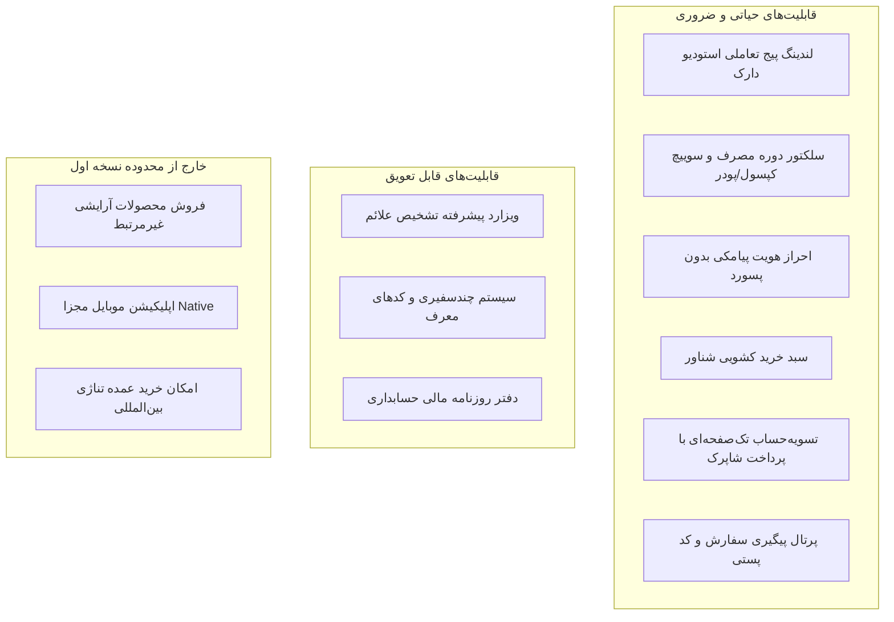

# 📄 سند نیازمندی‌های محصول (Product Requirements Document - PRD)
# Maya Spirulina Platform | پلتفرم فروش مستقیم مایا اسپیرولینا

---

## ۱. کشف مسئله و اعتبارسنجی بازار (Problem & Opportunity)

### ۱.۱. بیان مسئله
اسپیرولینا به عنوان غنی‌ترین منبع پروتئین، آنتی‌اکسیدان فیکوسیانین، آهن و کلروفیل شناخته می‌شود؛ اما در بازار کنونی:
1. **بی‌اعتمادی کیفی و واسطه‌ها:** خریداران نگران فلزات سنگین، آلودگی‌های مزارع غیراستاندارد و بسته‌بندی‌های غیراستریل هستند.
2. **سردرگمی در نحوه و دوره مصرف:** مصرف‌کنندگان تفاوت بین دوره‌های بازسازی، دوز روزانه ۵۰۰mg و فرمت کپسول در برابر پودر را نمی‌دانند.
3. **فروشگاه‌های سنتی با تجربه کاربری ضعیف:** فروشگاه‌های پیچیده با دسته‌بندی‌های نامرتبط، فرآیند خرید خسته‌کننده و عدم شفافیت در ارسال مرسوله پستی.

### ۱.۲. ارزش پیشنهادی مایا اسپیرولینا (Value Proposition)
- **شفافیت بالینی و آزمایشگاهی:** دسترسی عمومی به برگه آنالیز آزمایشگاهی هر پارت ساخت (Batch Analysis).
- **بسته‌های دوره مصرف ۳۰، ۶۰ و ۱۲۰ روزه:** ایجاد یک روتین سلامت مشخص به همراه ویزارد راهنمای علائم فردی.
- **خرید بدون واسطه و فوری:** لندینگ پیج تک‌محصولی جذاب و سفارش‌دهی با شماره موبایل در کمتر از ۹۰ ثانیه.

---

## ۲. مخاطبان و پرسونای خریداران (User Personas)

| پرسونا | مشخصات کلیدی | نیاز و دغدغه اصلی | انگیزه خرید از مایا |
| :--- | :--- | :--- | :--- |
| **۱. ورزشکاران و بدنسازان** | ۲۲ تا ۳۸ سال، فعال فیزیکی | ریکاوری سریع عضلانی، پروتئین ۶۵٪ خالص بدون مواد افزودنی | بسته ۱۲۰ روزه اقتصادی با گواهی عدم دوپینگ |
| **۲. مدیران و افراد پرمشغله** | ۳۰ تا ۵۵ سال، استرس و خستگی مزمن | رفع خستگی بدون کافئین مضر، انرژی پایدار در طول روز | کپسول‌های ۵۰۰ میلی‌گرم آسان‌مصرف ۳۰ روزه |
| **۳. بانوان و جویندگان زیبایی پوست/مو** | ۲۵ تا ۴۸ سال، دغدغه پیری زودرس و کم‌خونی | جذب آهن بالا بدون مشکلات گوارشی، شفافیت و کلاژن‌سازی | فرمول غنی از فیکوسیانین و کلروفیل خالص |
| **۴. پزشکان و مشاوران سلامت** | متخصصان تغذیه و طب تلفیقی | تجویز مکمل استاندارد برای مراجعان و بیماران | سیستم سفیران سلامت با پورسانت و کیت تست |

---

## ۳. محدوده قابلیت‌های نسخه اول (Scope & MoSCoW Prioritization)

### ۳.۱. قابلیت‌های ضروری (Must-Have - MVP)
- ویترین تک‌محصولی با رندر شیشه کهربایی دارویی و نورپردازی استودیو دارک.
- باکس آنالیز بیومارکرها (فیکوسیانین، پروتئین، آهن، کلروفیل، کلسیم).
- انتخاب سریع فرمت (کپسول ۵۰۰mg فشرده سرد / پودر خالص) و دوره مصرف (۳۰، ۶۰، ۱۲۰ روز).
- سیستم دراور سبد خرید کشویی با محاسبه سقف ارسال رایگان پستی (۸۰۰ هزار تومان).
- تسویه‌حساب سریع با ثبت نشانی، کدپستی ۱۰ رقمی و پرداخت اینترنتی شتاب.
- پیامک وضعیت ثبت سفارش و ارسال بارنامه پستی ۲۴ رقمی.

### ۳.۲. قابلیت‌های ارزش‌افزا و قابل تعویق (Could-Have / Phase 2)
- ویزارد بالینی ۶ مرحله‌ای تشخیص علائم خستگی و کمبود املاح.
- پرتال سفیران برند (پزشکان و مربیان) با پورسانت نقدی و تسویه حساب شبا.
- پنل کنترل انبار بر اساس پارت ساخت (Batch Number) و تاریخ انقضا.
- چت داخلی و سیستم پشتیبانی آنلاین تیکتی.

### ۳.۳. موارد خارج از محدوده (Out-of-Scope)
- تبدیل سایت به هایپرمارکت و فروش مکمل‌های شیمیایی متفرقه.
- اپلیکیشن اختصاصی iOS/Android (طراحی کاملاً PWA و واکنش‌گرا جایگزین آن است).
- فروش اعتباری باز بدون احراز هویت.

---

## ۴. داستان‌های کاربر با معیارهای پذیرش (User Stories & Acceptance Criteria)

### داستان ۱: انتخاب دوره مصرف و افزودن به سبد
> **به عنوان:** یک خریدار جدید  
> **می‌خواهم:** بتوانم دوره مصرف ۶۰ روزه کپسول را با مشاهده تخفیف انتخاب کنم  
> **تا:** با یک کلیک آن را به سبد خرید اضافه کرده و فرآیند خرید را تکمیل نمایم.
- **معیار پذیرش ۱:** تغییر انتخابگر دوره فوراً قیمت، درصد تخفیف و مبلغ نهایی را بدون رفرش صفحه به‌روز کند.
- **معیار پذیرش ۲:** کلیک روی دکمه «خرید مستقیم» در کمتر از ۲۰۰ میلی‌ثانیه دراور سبد خرید را باز کند و کالا افزوده شود.
- **حالت خطا:** اگر موجودی انبار به صفر رسیده باشد، دکمه به «اطلاع از موجودی» تغییر کرده و کاربر قادر به افزودن نباشد.

### داستان ۲: احراز هویت پیامکی سریع
> **به عنوان:** مشتری عجول  
> **می‌خواهم:** با وارد کردن شماره موبایل خود و دریافت کد پیامکی ۵ رقمی لاگین کنم  
> **تا:** نیازی به ثبت نام‌های طولانی و حفظ کلمه عبور نداشته باشم.
- **معیار پذیرش ۱:** پس از ورود موبایل، پیامک در کمتر از ۵ ثانیه ارسال و تایمر معکوس ۱۲۰ ثانیه‌ای فعال گردد.
- **معیار پذیرش ۲:** با ورود کد صحیح، کوکی امن `auth_token` ست شده و کاربر بدون وقفه به مرحله پرداخت منتقل شود.
- **حالت خطا:** در صورت ورود ۳ بار کد اشتباه، ارسال پیامک برای ۱۰ دقیقه قفل شده و پیام خطای مشخص نمایش داده شود.

### داستان ۳: پرداخت و دریافت فاکتور رسمی
> **به عنوان:** خریدار پرداخت‌کننده  
> **می‌خواهم:** فاکتور سفارش و کد پیگیری ۲۴ رقمی پست پیشتاز را دریافت کنم  
> **تا:** از اصالت سفارش و زمان ارسال کالا مطمئن باشم.
- **معیار پذیرش ۱:** پس از بازگشت موفق از درگاه، صفحه `/checkout/success` با شماره سفارش یکتا و دکمه چاپ فاکتور نمایش داده شود.
- **معیار پذیرش ۲:** سبد خرید به طور خودکار پاکسازی شده و پیامک حاوی شماره فاکتور برای مشتری ارسال شود.
- **حالت خطا:** در صورت انصراف یا خطای بانکی، سبد خرید مشتری حفظ شده و به صفحه تسویه‌حساب با توضیح علت خطا برگردد.

---

## ۵. نیازمندی‌های غیرکارکردی و کیفیتی (Non-Functional Requirements)

1. **سرعت و عملکرد (Performance):**
   - زمان نمایش اولین محتوای معنادار (LCP) زیر ۱.۲ ثانیه در بستر شبکه ایران.
   - نمره لایت‌هاوس بالای ۹۰ در بخش Performance و SEO.
2. **امنیت و محرمانگی (Security & Privacy):**
   - سشن‌ها با توکن‌های امضاشده JWT (`jose`) در کوکی‌های HttpOnly با فلگ‌های `SameSite=Lax` و `Secure`.
   - محافظت در برابر حملات تزریق SQL به کمک Prisma Parameterized Queries.
   - ریت‌لیمیتینگ روی روت‌های پیامک به کمک Redis جهت جلوگیری از حملات SMS-Flooding.
3. **طراحی بصری و دسترسی‌پذیری (Visual & A11y):**
   - تم رسمی Modern Dark Studio با نسبت کنتراست متن به پس‌زمینه حداقل ۴.۵:۱ (مطابق WCAG AA).
   - پشتیبانی بی‌نقص از صفحه‌خوان‌ها و ناوبری کامل با کیبورد.

---

## ۶. معیارهای سنجش موفقیت (Success Metrics & KPIs)
* **نرخ تبدیل خرید (Conversion Rate):** دستیابی به نرخ تبدیل حداقل ۳.۸٪ از بازدیدکنندگان لندینگ پیج.
* **میانگین ارزش سفارش (AOV):** افزایش تمایل خریداران به پکیج‌های ۶۰ و ۱۲۰ روزه تا سهم ۶۰٪ از کل فروش.
* **پایداری سیستم (Uptime):** دسترسی ۹۹.۹٪ بدون توقف سرویس در زمان کمپین‌های تبلیغاتی.
