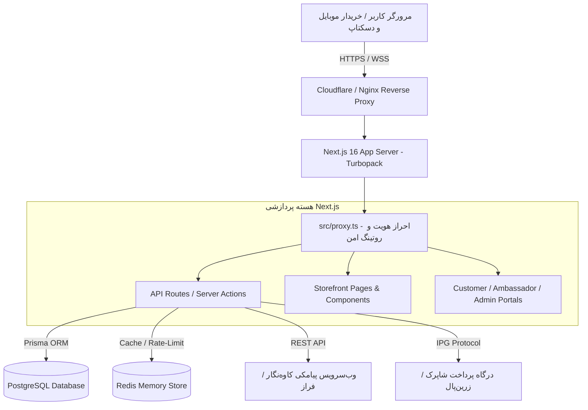

# 🛠️ سند طراحی فنی و معماری سیستم (Technical Architecture Blueprint)
# Maya Spirulina Platform | سند طراحی مهندسی سیستم

---

## ۱. نمای کلی معماری سیستم (System Architecture)

پلتفرم مایا اسپیرولینا بر پایه یک معماری یکپارچه مدرن (Modern Monolithic Full-Stack) با استفاده از **Next.js 16 (App Router)**، رندر ترکیبی سمت سرور (SSR) و کامپوننت‌های تعاملی سرور و کلاینت ساخته شده است.



---

## ۲. پشته فنی و استدلال انتخاب‌ها (Tech Stack Decisions)

| بخش | تکنولوژی انتخابی | دلیل انتخاب | گزینه‌های بررسی و ردشده |
| :--- | :--- | :--- | :--- |
| **فریم‌ورک هسته** | Next.js 16.4 (App Router) | عملکرد فوق‌العاده SSR، سئو عالی برای لندینگ، Turbopack سریع | Vite + SPA (سئوی ضعیف‌تر)، Remix (اکوسیستم محدودتر ایران) |
| **زبان** | TypeScript 5 | خطایابی زمان کامپایل، امنیت داده‌ها، هماهنگی کامل مدل‌های Prisma | JavaScript خام (خطاهای زمان اجرا در تراکنش‌های مالی) |
| **پایگاه داده** | PostgreSQL 16 | پشتیبانی عالی از تراکنش‌های ACID، پایداری بالا، انطباق با داده‌های مالی | MongoDB (داده‌های غیررابطه‌ای برای سفارشات و کیف‌پول مناسب نیست) |
| **ORM** | Prisma ORM | تایپ‌سیف بودن خودکار، مایگریشن‌های استاندارد، رابط کاربری Prisma Studio | TypeORM (پیچیدگی بیجا)، Drizzle (پشتیبانی کمتر از اکوسیستم Next.js) |
| **کنترل ریت‌لیمیت** | Redis (IORedis / Upstash) | ذخیره کدهای OTP با انقضای خودکار TTL و جلوگیری از ارسال رگباری | دیتابیس دیسکی (کندی I/O در زمان هجوم ترافیک پیامک) |
| **احراز هویت** | JWT ساین‌شده با `jose` | بدون حالت (Stateless)، امنیت بالا در کوکی HttpOnly، مقیاس‌پذیری ساده | احراز هویت Session مبتنی بر دیتابیس (سربار روی هر درخواست) |

---

## ۳. طرح داده و پایگاه داده (Data Schema - Prisma)

مدل داده در فایل `prisma/schema.prisma` پیاده‌سازی شده و شامل موجودیت‌های اصلی زیر است:

```prisma
enum Role {
  CUSTOMER           // خریدار عادی یا عضو باشگاه
  AMBASSADOR         // سفیر سلامت / پزشک همکار با کد معرف
  TRAINER            // مربی ورزشی همکار
  WAREHOUSE_MANAGER  // انباردار و مسئول بچ‌های اسپیرولینا
  ACCOUNTANT         // حسابدار و امور مالی
  ADMIN              // مدیر اجرایی
  SUPER_ADMIN        // مدیر ارشد با دسترسی کامل
}

enum OrderStatus {
  PENDING            // در انتظار پرداخت
  PAID               // پرداخت موفق و ثبت‌شده
  PROCESSING         // در حال بسته‌بندی در آزمایشگاه/انبار
  SHIPPED            // تحویل شده به پست پیشتاز با کد رهگیری
  DELIVERED          // تحویل نهایی به مشتری
  CANCELLED          // لغو شده یا ناموفق
}

enum ServingFormat {
  CAPSULE            // کپسول ۵۰۰mg فشرده سرد
  POWDER             // پودر خالص میکرونیزه
}

model User {
  id               String          @id @default(uuid())
  phone            String          @unique
  nationalCode     String?
  firstName        String?
  lastName         String?
  role             Role            @default(CUSTOMER)
  walletBalance    Int             @default(0) // به تومان
  loyaltyPoints    Int             @default(0)
  referralCode     String?         @unique
  referredById     String?
  orders           Order[]
  addresses        Address[]
  createdAt        DateTime        @default(now())
  updatedAt        DateTime        @updatedAt
}

model Product {
  id               String          @id @default(uuid())
  slug             String          @unique
  nameFa           String
  servingFormat    ServingFormat
  servingCount     Int             // مثلاً ۶۰ کپسول یا ۱۰۰ گرم
  durationDays     Int             // ۳۰، ۶۰ یا ۱۲۰ روز
  price            Int             // بهای مصرف‌کننده (تومان)
  discountPercent  Int             @default(0)
  stockQuantity    Int             @default(0)
  batchNumber      String          // شماره پارت ساخت آزمایشگاهی
  phycocyaninGrade String          // درصد فیکوسیانین خالص (مثلاً ۲۲٪)
  isActive         Boolean         @default(true)
  createdAt        DateTime        @default(now())
}
```

---

## ۴. قرارداد ای‌پی‌آی‌ها (API Contracts & Endpoints)

### ۴.۱. احراز هویت پیامکی بدون رمز (OTP Flow)
* **ارسال کد تایید:**  
  `POST /api/auth/otp/send`  
  - *درخواست:* `{ "phone": "09123456789" }`  
  - *پاسخ موفق:* `{ "success": true, "message": "کد تایید ارسال شد", "retryAfter": 120 }`  
  - *خطا:* `{ "error": "شماره موبایل نامعتبر است" }` یا `429 Too Many Requests`
* **تایید کد و دریافت سشن:**  
  `POST /api/auth/otp/verify`  
  - *درخواست:* `{ "phone": "09123456789", "code": "58214" }`  
  - *پاسخ موفق:* ست کردن کوکی HttpOnly با نام `auth_token` و بازگشت پروفایل کاربر.

### ۴.۲. فرآیند تسویه‌حساب و سفارش (Checkout & Orders)
* **ثبت سفارش و ارجاع به درگاه:**  
  `POST /api/orders/checkout`  
  - *درخواست:*
    ```json
    {
      "items": [{ "productId": "prod-1", "quantity": 1 }],
      "address": { "province": "تهران", "city": "تهران", "postalCode": "1234567890", "addressLine": "..." },
      "shippingMethod": "EXPRESS_POST",
      "couponCode": "MAYA10",
      "useWallet": true
    }
    ```
  - *پاسخ:* `{ "orderId": "ORD-140507-9821", "paymentUrl": "https://gateway.shaparak.ir/..." }`

---

## ۵. امنیت و کنترل سطوح دسترسی (Security & RBAC)

1. **لایه گیت‌وی با `src/proxy.ts`:**  
   این لایه تمامی درخواست‌های پرتال‌ها را پایش می‌کند:
   - درخواست‌های `/portal/admin/*` نیازمند نقش `ADMIN` یا `SUPER_ADMIN`.
   - درخواست‌های `/portal/ambassador/*` نیازمند نقش `AMBASSADOR`.
   - درخواست‌های `/portal/customer/*` نیازمند داشتن توکن معتبر لاگین.
2. **محافظت از CSRF و تزریق داده:**
   - متدهای جهش داده فقط از طریق `POST`/`PUT`/`DELETE` با بررسی معتبر بودن Origin.
   - اعتبارسنجی تمام ورودی‌ها با Zod Schema Validation.

---

## ۶. ریسک‌های اصلی و استراتژی رفع آنها (Risks & Mitigations)

| ریسک احتمالی | شدت | احتمال | اقدام پیشگیرانه |
| :--- | :---: | :---: | :--- |
| **قطع وب‌سرویس پیامک در ایران** | بالا | متوسط | پیاده‌سازی سرویس Fallback دوم و ارسال کد تست در محیط Development |
| **قطعی درگاه پرداخت شاپرک** | بالا | پایین | اتصال به درگاه واسط پشتیبان و ثبت لاگ دقیق تراکنش‌های معلق |
| **ترافیک ناگهانی روی سرور (Flash Sale)** | متوسط | متوسط | کش کردن داده‌های استاتیک در سطح CDN و ریت‌لیمیتینگ روی روت‌ها با ردیس |
| **ناسازگاری دیتابیس در زمان استقرار** | متوسط | پایین | اجرای خودکار `prisma migrate deploy` در پایپ‌لاین داکر قبل از راه‌اندازی |
