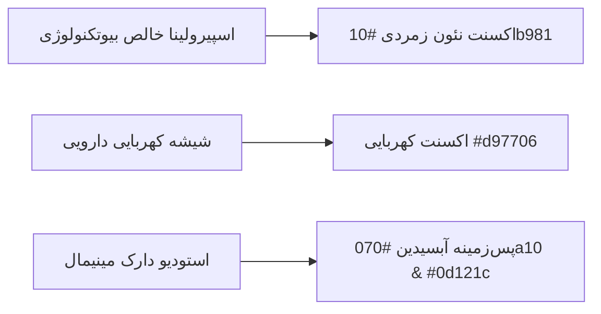
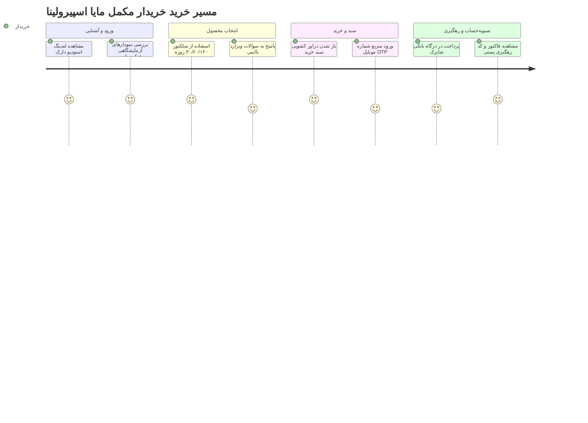

# 🎨 طرح تجربه و رابط کاربری (UI/UX Design Specification)
# Maya Spirulina Platform | سند طراحی بصری و تعاملی

---

## ۱. هویت بصری: استودیو دارک مدرن (Modern Dark Studio & High-End Bio-Tech)

طراحی مایا اسپیرولینا الهام‌گرفته از **استودیوهای عکاسی بیوتکنولوژی لوکس و روایت‌گری مینیمال اپل** است:
- **کانسپت فضا:** پس‌زمینه عمیق آبسیدین کربنی مات با احساس پاکیزگی استریل آزمایشگاهی.
- **محور بصری:** بطری شیشه‌ای دارویی کهربایی شناور با درب متالیک طلایی و درخشش نئون زمردی اسپیرولینا.
- **حس لمس و کاربری:** خطوط مویی هیرلاین ۱ پیکسلی با ترنزیشن‌های نرم و افکت رادیال اسپات‌لایت ماوس (`card-hover`).

---

## ۲. پالت رنگی رسمی و تایپوگرافی (Design Tokens)

### ۲.۱. توکن‌های رنگی
- **پس‌زمینه اصلی (Canvas):** `#070a10` (آبسیدین مات)
- **سطوح کارت‌ها (Card Surface):** `#0d121c` با حاشیه مویی `rgba(255, 255, 255, 0.08)`
- **اکسنت شاخص (Brand Emerald):** `#10b981` (Emerald 500) و حالت هاور `#34d399`
- **اکسنت مکمل (Pharma Amber):** `#d97706` (رنگ کپسول و شیشه کهربایی)
- **متن اصلی:** `#f8fafc` | **متن ثانویه:** `#94a3b8`

### ۲.۲. تایپوگرافی و ارقام
- **فونت رسمی:** **وزیرمتن (Vazirmatn)** در تمام اوزان (Normal 400, Medium 500, Bold 700).
- **قانون اعداد:** تمامی اعداد قیمت، روزهای مصرف و درصدها با تابع `formatToman` و `toPersianDigits` کاملاً فارسی رندر می‌شوند.

---

## ۳. نقشه سفر کاربر (Customer Journey Map)

---

## ۴. فهرست صفحات و حالت‌های چهارگانه (States Specification)

دستورالعمل استاندارد الزام می‌کند هر صفحه در ۴ وضعیت تعریف شود:

### ۴.۱. صفحه ویترین لندینگ اصلی (`/`)
1. **حالت بارگذاری (Loading):** اسکلتون دارک شیشه‌ای با افکت شیمر (Shimmer) روی هیرو بنر و کارت‌های تغذیه‌ای.
2. **حالت خالی (Empty):** در این صفحه مصداق ندارد (محتوای هیرو و فرمولاسیون ثابت است).
3. **حالت خطا (Error):** نمایش پیام شیشه‌ای «ارتباط با پایگاه داده برقرار نشد» با دکمه «تلاش مجدد».
4. **حالت موفق (Success):** رندر کامل لندینگ، نمودارهای متحرک بیومارکرها، سلکتور بسته و فوتر برند.

### ۴.۲. دراور کشویی سبد خرید (`CartDrawer`)
1. **حالت خالی (Empty):** آیکون سبد خالی با هاله زمردی، متن «سبد سلامت شما خالی است» و دکمه هدایت «مشاهده دوره‌های اسپیرولینا».
2. **حالت بارگذاری (Loading):** اسپینر ظریف زمردی روی دکمه ثبت سفارش هنگام محاسبه ارسال.
3. **حالت خطا (Error):** نوار قرمز مات با پیام «موجودی پکیج انتخاب‌شده به پایان رسیده است».
4. **حالت موفق (Success):** نمایش ردیف‌های سبد خرید، شمارنده افزایش/کاهش، پروگرس‌بار ارسال رایگان (بالای ۸۰۰ هزار تومان) و دکمه پرداخت.

### ۴.۳. صفحه تسویه‌حساب (`/checkout`)
1. **حالت بارگذاری (Loading):** اسکلتون فرم آدرس و پیش‌فاکتور.
2. **حالت خالی (Empty):** در صورت ورود با سبد خالی، هدایت خودکار کاربر به صفحه اصلی ظرف ۱ ثانیه.
3. **حالت خطا (Error):** حاشیه‌های قرمز مات دور اینپوت‌های نامعتبر (کدپستی نادرست، عدم انتخاب شهر) همراه با توضیح خطا.
4. **حالت موفق (Success):** فرم کامل آدرس، انتخاب شیوه پست پیشتاز/اکسپرس، اعمال کوپن تخفیف و انتقال مستقیم به درگاه.

### ۴.۴. پرتال‌های کاربری و ادمین (`/portal/*`)
1. **حالت بارگذاری (Loading):** اسکلتون ردیف‌های جداول `.data-table` و کارت‌های ۴ گانه شاخص‌های کلیدی.
2. **حالت خالی (Empty):** در جدول سفارشات: «هنوز سفارشی ثبت نشده است» همراه با تصویر وکتور خطی مینیمال.
3. **حالت خطا (Error):** پیام دسترسی غیرمجاز (`۴۰۳ Forbidden`) برای نقش‌های نامعتبر با دکمه بازگشت به پنل مربوطه.
4. **حالت موفق (Success):** داشبورد کامل آماری، نمودارهای پویا، فیلترهای زنده و پالت فرمان کیبورد (`Ctrl+K`).

---

## ۵. ملاحظات موبایل و دسترسی‌پذیری (Mobile & Accessibility)

* **Mobile-First UX:**
  - نوار چسبان پایینی (Sticky Bottom Bar) در نسخه موبایل برای خرید سریع بسته منتخب.
  - دراور سبد خرید کشویی از پایین صفحه (Bottom Sheet) در نمایشگرهای زیر ۶۴۰ پیکسل.
  - ابعاد استاندارد دکمه‌های لمسی: حداقل ارتفاع ۴۸ پیکسل برای جلوگیری از لمس اشتباه.
* **دسترس‌پذیری (WCAG 2.1 AA):**
  - تگ‌های معنایی کامل (`header`, `main`, `section`, `article`, `footer`).
  - ویژگی‌های `aria-label` و `aria-expanded` برای منوها، دراورها و مودال‌ها.
  - قابلیت کامل ناوبری با کیبورد و کلید Tab و بستن پاپ‌آپ‌ها با کلید `Escape`.
